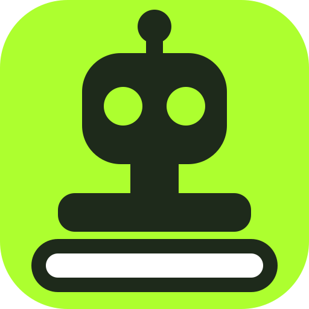
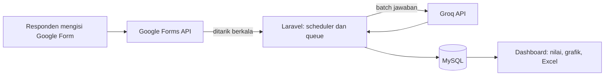

<div align="center">

<h1 Essay Grader</h1>

<p><b>Penilai Esai Otomatis</b><br>
Nilai jawaban esai dari <b>Google Form</b> secara otomatis dengan bantuan AI,<br>
lengkap dengan tabel nilai, grafik sebaran, dan unduhan Excel.</p>

<p>
<a href="https://github.com/Xanderizm/Essay-Grader/actions"></a>
<a href="LICENSE"></a>


</p>

<p>


</p>

<p>
<a href="#-daftar-isi">Daftar isi</a> ·
<a href="#-alur-kerja">Alur kerja</a> ·
<a href="#-2-clone-proyek-dan-instalasi-dependency">Instalasi</a> ·
<a href="#-6-cara-menggunakan-aplikasi-dengan-akun-sendiri">Cara pakai</a> ·
<a href="#-10-pemecahan-masalah">Troubleshooting</a>
</p>

</div>

---

Aplikasi web Laravel untuk menilai jawaban esai dari **Google Form** dengan bantuan AI. Pembuat penilaian menempelkan link Google Form, mengatur rubrik (opsional), lalu jawaban responden ditarik otomatis dari Google dan dinilai oleh model AI pada tiga aspek: **Pemahaman Konten**, **Logika Argumen**, dan **Struktur Tulisan**. Hasilnya tampil sebagai tabel nilai, grafik sebaran, dan file Excel (CSV).

> [!NOTE]
> Nilai dari AI adalah bantuan penilaian. Keputusan akhir ada pada pembuat penilaian, yang bisa mengoreksi setiap nilai.

## ✨ Fitur utama

- 🔐 Login dengan email dan password atau akun Google, verifikasi email, dan lupa password.
- 🔗 Hubungkan akun Google (izin **hanya baca**) lalu tempel link Google Form. Struktur Form dibaca otomatis.
- 🎛️ Pertanyaan bertipe **Paragraph** dapat diatur **Dinilai** atau **Tidak dinilai**. Rubrik bersifat opsional: jika kosong, AI menilai secara mandiri.
- ⚙️ Jawaban ditarik dari Google Form secara berkala, lalu dinilai AI per kelompok (batching) lewat antrean.
- 📊 Tabel nilai dengan cari, urut, grafik sebaran, koreksi nilai manual, dan unduhan Excel.
- 👥 Banyak pengguna: setiap pembuat hanya melihat data miliknya. Ada kuota harian AI dan opsi memakai kunci AI sendiri.

## 🔄 Alur kerja



## 📚 Daftar isi

1. [Prasyarat sistem](#-1-prasyarat-sistem)
2. [Clone proyek dan instalasi dependency](#-2-clone-proyek-dan-instalasi-dependency)
3. [Konfigurasi file .env](#-3-konfigurasi-file-env)
4. [Setup database dan migrasi](#-4-setup-database-dan-migrasi)
5. [Menjalankan server lokal](#-5-menjalankan-server-lokal)
6. [Cara menggunakan aplikasi dengan akun sendiri](#-6-cara-menggunakan-aplikasi-dengan-akun-sendiri)
7. [Pengujian otomatis](#-7-pengujian-otomatis)
8. [Perintah yang berguna](#-8-perintah-yang-berguna)
9. [Struktur proyek](#-9-struktur-proyek)
10. [Pemecahan masalah](#-10-pemecahan-masalah)
11. [Keamanan dan catatan produksi](#-11-keamanan-dan-catatan-produksi)

---

## 📋 1. Prasyarat sistem

| Perangkat | Versi | Keterangan |
|---|---|---|
| PHP | 8.2 atau lebih baru (dikembangkan dengan 8.3) | Ekstensi: `mbstring`, `openssl`, `pdo_mysql`, `curl`, `fileinfo`, `json`, `xml`, `ctype`, `tokenizer` |
| Composer | 2.x | Pengelola dependency PHP |
| MySQL | 8.0 atau lebih baru (MariaDB 10.5+ umumnya cocok) | Proyek memakai kolom JSON dan enum |
| Laragon atau XAMPP | Terbaru | Laragon (Windows) paling mudah: PHP, MySQL, dan Composer sudah termasuk |
| Git | Terbaru | Untuk meng-clone repository |
| Node.js | 18 atau lebih baru (**opsional**) | Lihat catatan di bagian 2 |

Akun layanan yang dibutuhkan (semuanya gratis):

- **Akun Google** untuk membuat kredensial OAuth di Google Cloud dan memiliki Google Form uji.
- **Akun Groq** (console.groq.com) untuk kunci API model AI.

Cek versi yang terpasang:

```bash
php -v
composer -V
mysql --version
git --version
```

> [!TIP]
> Pengguna Laragon: buka **Terminal** dari jendela Laragon. Terminal itu sudah mengenali `php`, `composer`, dan `mysql`.

---

## 📦 2. Clone proyek dan instalasi dependency

```bash
git clone https://github.com/Xanderizm/Essay-Grader.git
cd Essay-Grader
```

> [!TIP]
> Jika Anda melakukan fork, ganti `Xanderizm/Essay-Grader` dengan alamat repository Anda. Pengguna Laragon sebaiknya meng-clone ke `C:\laragon\www`.

### Mengapa folder `vendor/` tidak ada?

Folder `vendor/` berisi paket pihak ketiga, ukurannya besar, dan sengaja **tidak disimpan di Git** (tercantum di `.gitignore`). Daftar versi pastinya tersimpan di `composer.lock`, sehingga `composer install` selalu menghasilkan paket yang sama untuk semua developer.

```bash
composer install
```

### Aset frontend

> [!NOTE]
> Antarmuka memakai CSS dan JavaScript statis (`public/js/app.js`) serta font dari Google Fonts, sehingga **tidak ada langkah build** dan komputer perlu terhubung ke internet. Jalankan perintah berikut hanya jika repository Anda memuat `package.json` dan layout memakai `@vite`:

```bash
npm install
npm run build
```

---

## 🔑 3. Konfigurasi file .env

File `.env` berisi pengaturan dan rahasia yang berbeda untuk setiap komputer, dan **tidak boleh di-commit**. Buat dari contoh:

```bash
# Windows (Command Prompt / Laragon Terminal)
copy .env.example .env

# macOS / Linux / Git Bash
cp .env.example .env
```

Buat kunci aplikasi:

```bash
php artisan key:generate
```

> [!WARNING]
> `APP_KEY` dipakai untuk mengenkripsi kunci API dan token Google yang tersimpan di database. Jika kunci ini berubah atau hilang, data terenkripsi itu tidak bisa dibaca lagi dan harus dimasukkan ulang. Cadangkan nilainya.

Buka `.env` dan sesuaikan bagian berikut. Jika `.env.example` belum memuat variabel proyek ini, tambahkan sendiri.

### 3.1 Aplikasi

```env
APP_NAME="Penilai Esai"
APP_ENV=local
APP_DEBUG=true
APP_URL=http://127.0.0.1:8000
APP_LOCALE=id
APP_FALLBACK_LOCALE=en
```

> [!IMPORTANT]
> `APP_URL` harus sama persis dengan alamat yang Anda buka di browser. Nilai ini dipakai untuk tautan di email dan harus cocok dengan alamat balik Google. Pakai `127.0.0.1`, **bukan** `localhost`.

### 3.2 Database MySQL (wajib diganti)

```env
DB_CONNECTION=mysql
DB_HOST=127.0.0.1
DB_PORT=3306
DB_DATABASE=essay_grader
DB_USERNAME=root
DB_PASSWORD=

QUEUE_CONNECTION=database
SESSION_DRIVER=database
CACHE_STORE=database
```

| Variabel | Isi |
|---|---|
| `DB_DATABASE` | Nama database yang Anda buat di bagian 4 |
| `DB_USERNAME` | Pengguna MySQL. Laragon bawaan: `root` |
| `DB_PASSWORD` | Password MySQL. Laragon bawaan: **kosong** |

### 3.3 Google Cloud (wajib diganti)

Aplikasi memakai **Google Forms API** lewat OAuth 2.0. Setiap pengembang membuat kredensial sendiri:

1. Buka **console.cloud.google.com**, lalu buat project baru (misalnya `essay-grader`).
2. **APIs & Services → Library**, cari **Google Forms API**, lalu klik **Enable**.
3. Buka **Google Auth Platform** dan isi layar persetujuan:
   - **Branding:** nama aplikasi dan email dukungan.
   - **Audience:** pilih **External**. Status awal adalah *Testing*. Pada **Test users**, tambahkan semua email Google yang akan mencoba aplikasi (termasuk email Anda sendiri).
   - **Data Access:** tambahkan izin berikut.
     ```text
     openid
     https://www.googleapis.com/auth/userinfo.email
     https://www.googleapis.com/auth/userinfo.profile
     https://www.googleapis.com/auth/forms.body.readonly
     https://www.googleapis.com/auth/forms.responses.readonly
     ```
4. **Clients → Create client**, jenis **Web application**. Pada **Authorized redirect URIs**, tambahkan **kedua** alamat ini persis:
   ```text
   http://127.0.0.1:8000/google/callback
   http://127.0.0.1:8000/auth/google/callback
   ```
5. Salin **Client ID** dan **Client secret** (secret mungkin hanya tampil sekali), lalu isi `.env`:

```env
GOOGLE_CLIENT_ID=isi-client-id-anda.apps.googleusercontent.com
GOOGLE_CLIENT_SECRET=isi-client-secret-anda
GOOGLE_REDIRECT_URI=http://127.0.0.1:8000/google/callback
GOOGLE_LOGIN_REDIRECT_URI=http://127.0.0.1:8000/auth/google/callback
```

> [!NOTE]
> Selama aplikasi Google Cloud berstatus *Testing*, hanya akun di daftar **Test users** yang bisa menyambungkan Google, dan izin kedaluwarsa tiap 7 hari (cukup hubungkan ulang). Google menampilkan peringatan "belum diverifikasi"; klik **Lanjutan** lalu lanjutkan. Itu normal untuk pengembangan lokal.

### 3.4 Kunci Groq (TIDAK ditaruh di .env)

Berbeda dari kredensial lain, kunci Groq **disimpan terenkripsi di database** dan dimasukkan lewat halaman web setelah login. Ini memungkinkan beberapa kunci bergiliran dan kunci per pengguna.

1. Buka **console.groq.com → API Keys → Create API Key**.
2. Salin kunci yang diawali `gsk_` (hanya tampil sekali).
3. Masukkan di aplikasi setelah login (lihat bagian 6, langkah 3).

Model yang dipakai ditetapkan di `app/Services/AiGradingService.php` (konstanta `MODELS`). Jika Groq menghentikan sebuah model, ganti namanya di sana.

### 3.5 Email

Untuk pengembangan lokal, biarkan email ditulis ke log:

```env
MAIL_MAILER=log
```

Tautan verifikasi email dan reset password lalu muncul di `storage/logs/laravel.log` (cari kata `verify` atau `reset-password`).

Untuk mengirim email sungguhan (contoh Gmail; butuh verifikasi 2 langkah dan "Sandi aplikasi" dari `myaccount.google.com/apppasswords`):

```env
MAIL_MAILER=smtp
MAIL_HOST=smtp.gmail.com
MAIL_PORT=587
MAIL_USERNAME=alamat-anda@gmail.com
MAIL_PASSWORD=sandi-aplikasi-16-karakter
MAIL_FROM_ADDRESS=alamat-anda@gmail.com
MAIL_FROM_NAME="Penilai Esai"
```

> [!NOTE]
> Email dikirim lewat antrean, jadi `php artisan queue:work` harus berjalan (bagian 5).

### 3.6 Pengaturan opsional

```env
REGISTRATION_MODE=open        # open = siapa saja boleh daftar; invite = perlu kode; closed = ditutup
REGISTRATION_CODE=            # isi jika REGISTRATION_MODE=invite
AI_DAILY_QUOTA=300            # batas jawaban per pengguna per hari pada kunci bersama
RETENTION_DAYS=               # isi angka hari untuk menghapus otomatis penilaian lama yang tidak aktif
MYSQLDUMP_PATH=               # isi jalur mysqldump jika perintah db:backup gagal menemukannya
```

Setelah mengubah `.env`, bersihkan cache konfigurasi:

```bash
php artisan config:clear
```

---

## 💾 4. Setup database dan migrasi

Buat database kosong dengan nama yang sama seperti `DB_DATABASE`. Lewat MySQL Workbench, HeidiSQL (bawaan Laragon), atau phpMyAdmin, jalankan:

```sql
CREATE DATABASE essay_grader CHARACTER SET utf8mb4 COLLATE utf8mb4_unicode_ci;
```

Jalankan migrasi untuk membuat semua tabel:

```bash
php artisan migrate
```

Periksa bahwa semua migrasi berstatus `Ran`:

```bash
php artisan migrate:status
```

### Data contoh (opsional)

Jika repository menyertakan seeder, data contoh dapat dibuat **setelah Anda mendaftarkan satu akun** (seeder mengambil pengguna pertama):

```bash
php artisan db:seed
```

> [!NOTE]
> Penilaian contoh memakai ID Google Form palsu, jadi hanya berguna untuk melihat tampilan. Penarikan jawabannya dari Google akan gagal. Hapus penilaian contoh setelah dicoba.

---

## 🚀 5. Menjalankan server lokal

> [!NOTE]
> Aplikasi membutuhkan **tiga proses** yang berjalan bersamaan. Buka tiga jendela terminal di folder proyek.

**Terminal 1: server web**

```bash
php artisan serve
```

Buka **http://127.0.0.1:8000** di browser.

**Terminal 2: pekerja antrean (queue worker)**

```bash
php artisan queue:work
```

Mengerjakan analisis Form, penilaian AI, pengiriman email, dan penarikan jawaban dari Google.

**Terminal 3: penjadwal (scheduler)**

```bash
php artisan schedule:work
```

Menjalankan tugas terjadwal: menarik jawaban baru dari Google Form tiap menit, cadangan database harian, dan pembersihan antrean gagal.

> [!IMPORTANT]
> Setiap kali Anda mengubah kode PHP, **hentikan lalu jalankan ulang `queue:work`** (Ctrl+C). Pekerja menyimpan kode lama di memori.

### Memakai virtual host Laragon

> [!WARNING]
> Laragon dapat menyajikan proyek di alamat seperti `http://nama-proyek.test`. Itu berfungsi untuk aplikasi, tetapi **OAuth Google hanya menerima `http` pada `127.0.0.1` atau `localhost`**. Jika memakai virtual host, Anda perlu HTTPS dengan domain yang diterima Google. Untuk pengembangan lokal, cara paling mudah adalah tetap memakai `php artisan serve`.

> [!TIP]
> Jika port 8000 sudah dipakai, jalankan `php artisan serve --port=8001`, lalu ubah `APP_URL` dan kedua alamat balik Google (di `.env` dan di Google Cloud) menjadi port yang sama.

---

## 🧭 6. Cara menggunakan aplikasi dengan akun sendiri

### Langkah 1. Buat akun dan jadikan admin

1. Buka `http://127.0.0.1:8000/register`, lalu daftar dengan email, password (minimal 10 karakter), dan centang persetujuan.
2. Verifikasi email dengan membuka tautan di `storage/logs/laravel.log` (jika `MAIL_MAILER=log`) atau di kotak masuk.
3. Jadikan akun pertama sebagai **admin** (diperlukan untuk mengelola kunci AI bersama). Buka `php artisan tinker`, lalu jalankan:

```php
App\Models\User::where('email', 'email-anda@contoh.com')->update(['is_admin' => true]);
```

### Langkah 2. Hubungkan akun Google

Buka menu **Google** lalu klik **Hubungkan Google**. Pilih akun yang **memiliki Google Form** Anda dan centang semua izin. Izinnya hanya baca, jadi aplikasi tidak dapat mengubah atau menghapus Form Anda. Gunakan kotak **Coba baca Google Form** untuk memastikan koneksi berfungsi.

### Langkah 3. Masukkan kunci Groq

- **Admin:** menu **API Key** (`/keys`) untuk menambahkan kunci bersama. Klik **Tes** pada kunci yang baru ditambahkan.
- **Pengguna biasa:** menu **AI saya** (`/kunci-ai`) untuk kunci pribadi. Penilaian lalu memakai kunci itu dan tidak dibatasi kuota bersama.

### Langkah 4. Buat penilaian dari Google Form

1. Di Google Forms, buka Form Anda dalam **mode edit** dan salin alamat dari address bar. Alamatnya harus diawali `https://docs.google.com/forms` dan berisi `/edit`. Link untuk responden (`/viewform`) tidak bisa dipakai.
2. Di aplikasi, klik **Buat penilaian baru**, tempel link, lalu klik **Analisis Form**.
3. Tunggu status berubah menjadi **Analisis berhasil**. Tabel **Susunan Formulir** menampilkan jenis tiap isian.

> [!NOTE]
> Form harus dimiliki oleh akun Google yang terhubung. Form harus punya minimal satu pertanyaan bertipe **Paragraph** agar bisa dinilai.

### Langkah 5. Atur mode penilaian dan rubrik

Pada bagian **Rubrik Penilaian**, untuk setiap pertanyaan Paragraph:

- Pilih mode **Dinilai** atau **Tidak dinilai**. AI memberi pilihan awal, dan Anda dapat mengubahnya.
- Isi **rubrik** (opsional). Jika kosong, AI menilai sendiri berdasarkan isi jawaban. Jika diisi, AI menilai berdasarkan rubrik itu.
- Klik **Simpan perubahan** (tombol ini hanya muncul bila ada perubahan).

### Langkah 6. Aktifkan penilaian

Klik **Aktifkan penilaian**. Penilaian hanya bisa diaktifkan jika ada minimal satu pertanyaan Paragraph berstatus **Dinilai**. Setelah aktif:

- Jawaban baru ditarik dari Google Form secara otomatis.
- Jawaban dinilai AI melalui antrean: setiap jawaban mendapat skor 0 sampai 100 pada tiga aspek, nilai akhir (rata-rata), dan kategori (Sangat Baik, Baik, Cukup, Kurang).
- Selama penilaian aktif, susunan formulir dan rubrik **tidak bisa diubah**. Tutup penilaian lebih dulu bila ingin mengubahnya.

### Langkah 7. Lihat dan koreksi nilai

Buka **Lihat Nilai**:

- Ringkasan, sebaran nilai (grafik), serta cari dan urut tabel.
- Buka **Jawaban dan alasan nilai** pada setiap sel untuk membaca jawaban, rubrik, dan alasan AI.
- Koreksi skor secara manual. Koreksi Anda tidak tertimpa saat penilaian ulang, dan bisa dikembalikan ke nilai AI.
- **Unduh Nilai (Excel)** menghasilkan file CSV yang terbuka langsung di Excel.

### Langkah 8. Mencoba penilaian dengan Form sendiri

Untuk uji cepat, buat Google Form dengan kolom **Nama** (Jawaban singkat) dan dua pertanyaan **Paragraph**. Aktifkan penilaian, isi Form sebagai beberapa responden lewat link responden (`Kirim → ikon tautan`), tunggu sekitar satu menit, lalu buka **Lihat Nilai**. Contoh jawaban uji: satu jawaban benar dengan kata-kata berbeda, satu setengah benar, dan satu tidak relevan.

### Pengelolaan akun

Menu nama pengguna di pojok kanan atas membuka halaman **Akun**: ganti password, unduh seluruh data, dan hapus akun. Menghapus akun menghapus seluruh penilaian, jawaban, dan nilai milik Anda.

---

## 🧪 7. Pengujian otomatis

Pengujian memakai **database terpisah** karena setiap uji membuat ulang semua tabel. Buat database uji:

```sql
CREATE DATABASE essay_grader_test CHARACTER SET utf8mb4 COLLATE utf8mb4_unicode_ci;
```

Pada `phpunit.xml`, di dalam blok `<php>`, pastikan baris ini ada:

```xml
<env name="DB_CONNECTION" value="mysql" force="true"/>
<env name="DB_DATABASE" value="essay_grader_test" force="true"/>
<env name="QUEUE_CONNECTION" value="null" force="true"/>
```

Jalankan:

```bash
php artisan config:clear
php artisan test
```

> [!WARNING]
> `tests/TestCase.php` menolak berjalan jika nama database tidak berakhiran `_test`. Itu disengaja agar data asli tidak terhapus. Jangan menghapus pengaman itu.

---

## 🔨 8. Perintah yang berguna

> [!NOTE]
> Daftar ini mengikuti kode saat dokumen ditulis. Jalankan `php artisan list` untuk melihat perintah yang tersedia di versi Anda.

| Perintah | Fungsi |
|---|---|
| `php artisan exams:sync` | Menjadwalkan penarikan jawaban untuk semua penilaian aktif |
| `php artisan db:backup` | Membuat cadangan database ke `storage/app/backups` |
| `php artisan exams:prune --days=30` | Simulasi penghapusan penilaian lama yang tidak aktif (tambahkan `--force` untuk menghapus) |
| `php artisan accounts:purge` | Menghapus permanen akun yang masa tenggang penghapusannya habis |
| `php artisan migrate:status` | Memeriksa status migrasi |
| `php artisan route:list` | Melihat semua rute |
| `php artisan config:clear` | Membersihkan cache konfigurasi setelah mengubah `.env` |
| `php artisan view:clear` | Membersihkan cache tampilan Blade |
| `php artisan queue:failed` | Melihat pekerjaan antrean yang gagal |

Memulihkan cadangan: di MySQL Workbench, **Server → Data Import → Import from Self-Contained File**, lalu pilih schema tujuan.

---

## 📁 9. Struktur proyek

| Lokasi | Isi |
|---|---|
| `app/Services/` | Logika inti: `FormAnalyzerService` (analisis Form), `EssayGraderService` dan `AiGradingService` (penilaian AI), `GoogleClient` dan `GoogleLogin` (OAuth), `ResponseSyncService` (menyimpan jawaban) |
| `app/Jobs/` | Pekerjaan antrean: `AnalyzeExamForm`, `SyncExamResponses`, `ProcessEssayGrading` |
| `app/Support/` | Pembantu: `Friendly` (pesan galat ramah), `LiveState` (status polling), `Quota` (kuota AI) |
| `app/Http/Controllers/` | Controller halaman: penilaian, hasil, akun, kunci AI, autentikasi |
| `app/Console/Commands/` | Perintah artisan kustom (sinkronisasi, cadangan, pembersihan) |
| `config/grading.php` | Bobot aspek dan batas kategori nilai |
| `config/google.php`, `config/registration.php` | Konfigurasi Google dan pendaftaran |
| `routes/web.php`, `routes/console.php` | Rute web dan jadwal tugas |
| `resources/views/` | Tampilan Blade |
| `public/js/app.js` | JavaScript antarmuka (polling, grafik, popup, navigasi) |
| `database/migrations/` | Skema database |
| `tests/` | Uji otomatis |

> [!TIP]
> Aturan penilaian dapat disesuaikan di `config/grading.php`: bobot ketiga aspek dan ambang kategori (Sangat Baik mulai 85, Baik 70, Cukup 55).

---

## 🩺 10. Pemecahan masalah

| Gejala | Penyebab dan solusi |
|---|---|
| `Error 400: redirect_uri_mismatch` dari Google | Alamat balik di Google Cloud tidak sama persis dengan `.env`. Pastikan keduanya terdaftar, memakai `http`, `127.0.0.1`, dan tanpa garis miring di akhir. |
| `Error 403: access_denied` | Akun Google belum masuk **Test users** di Google Auth Platform. |
| "Sesi tidak cocok" saat menyambungkan Google | Aplikasi dibuka lewat `localhost`. Buka lewat `http://127.0.0.1:8000`. |
| `Google Forms API belum diaktifkan` | Aktifkan **Google Forms API** di project yang sama dengan kredensial OAuth, lalu tunggu 1-2 menit. |
| "Form tidak ditemukan atau tidak punya akses" | Form harus dimiliki akun Google yang terhubung, dan link harus dari mode edit (`/edit`). |
| Status jawaban tetap "Menunggu" | `queue:work` atau `schedule:work` belum berjalan, atau belum di-restart setelah mengubah kode. |
| "Layanan AI sedang sibuk" atau "penuh" | Server Groq sedang padat atau kuota habis. Sistem mencoba lagi otomatis. Tambahkan kunci kedua atau coba beberapa menit lagi. |
| `Unknown column ...` atau `Base table not found` | Migrasi belum dijalankan penuh. Jalankan `php artisan migrate` dan periksa `migrate:status`. |
| `The payload is invalid` | `APP_KEY` berubah setelah data terenkripsi dibuat. Masukkan ulang kunci Groq dan hubungkan ulang Google. |
| Email aktivasi tidak sampai | Jika `MAIL_MAILER=log`, tautannya ada di `storage/logs/laravel.log`. Untuk email sungguhan, atur SMTP dan jalankan `queue:work`. |
| `419 Page Expired` | Cookie sesi kedaluwarsa atau `APP_URL` berbeda dengan alamat yang dibuka. Muat ulang dan periksa `.env`. |
| `Namespace declaration statement has to be the very first statement` | Sebuah berkas PHP tersimpan dengan BOM. Simpan ulang sebagai UTF-8 **tanpa BOM**. |
| `Class "..." not found` | Jalankan `composer dump-autoload`, lalu `php artisan config:clear`. |
| Perubahan `.env` tidak terbaca | Jalankan `php artisan config:clear`, lalu restart `php artisan serve`. |
| `mysqldump` tidak ditemukan saat `db:backup` | Isi `MYSQLDUMP_PATH` di `.env` dengan jalur lengkap `mysqldump.exe`. |
| Port 8000 sudah dipakai | Jalankan `php artisan serve --port=8001` dan samakan `APP_URL` serta alamat balik Google. |

> [!TIP]
> Log aplikasi ada di `storage/logs/laravel.log`. Sertakan 10-15 baris terakhirnya saat melaporkan masalah.

---

## 🔒 11. Keamanan dan catatan produksi

> [!CAUTION]
> Jangan pernah meng-commit `.env`, kunci Groq, Client secret Google, atau berkas cadangan database (`storage/app/backups`).

> [!WARNING]
> Jika ada rahasia yang sempat terbagikan (tangkapan layar, chat, commit), buat ulang rahasia itu: kunci Groq di console.groq.com dan Client secret di Google Cloud.

- Untuk penggunaan oleh banyak orang, set `APP_ENV=production`, `APP_DEBUG=false`, dan `APP_URL` ke domain HTTPS. Jalankan `queue:work` dan `schedule:work` sebagai layanan yang hidup terus.
- Aplikasi Google berstatus *Testing* dibatasi untuk akun uji. Untuk pengguna umum, aplikasi perlu dipublikasikan, dan di atas 100 pengguna perlu verifikasi dari Google (butuh domain milik sendiri, halaman beranda, dan kebijakan privasi).
- Gunakan database terkelola atau MySQL di server dengan cadangan rutin. Atur `MYSQL_ATTR_SSL_CA` bila penyedia mewajibkan TLS.
- Data jawaban responden bersifat pribadi. Sediakan kebijakan privasi (`/privasi`) dan ketentuan layanan (`/ketentuan`) yang sudah Anda sesuaikan sebelum dipakai publik.

---

## 📄 Lisensi

Dirilis di bawah lisensi **MIT**. Lihat berkas [`LICENSE`](LICENSE) di root repository.

<div align="center">

<sub>Dibuat dengan Laravel · [Xanderizm/Essay-Grader](https://github.com/Xanderizm/Essay-Grader)</sub>

</div>

