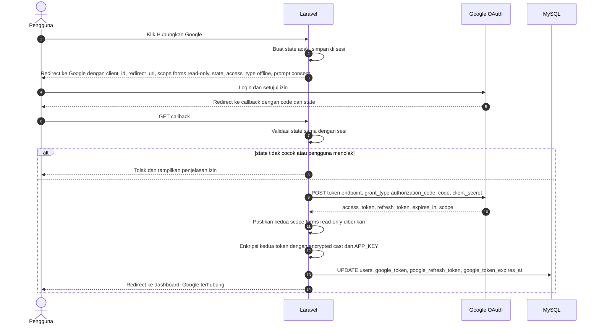
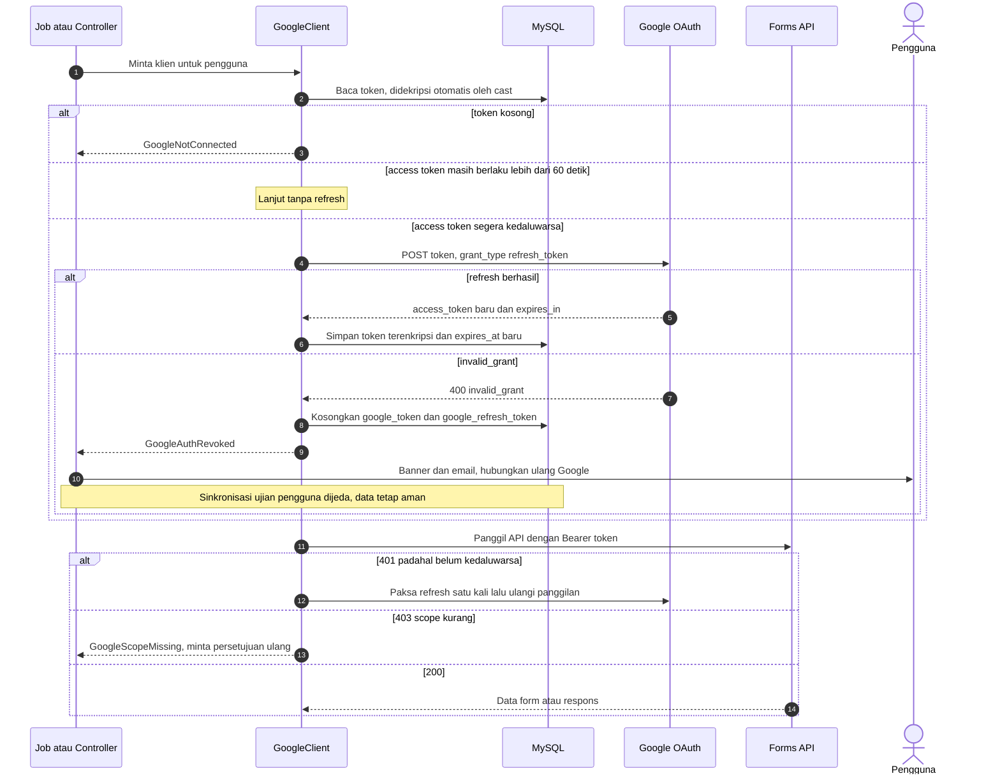
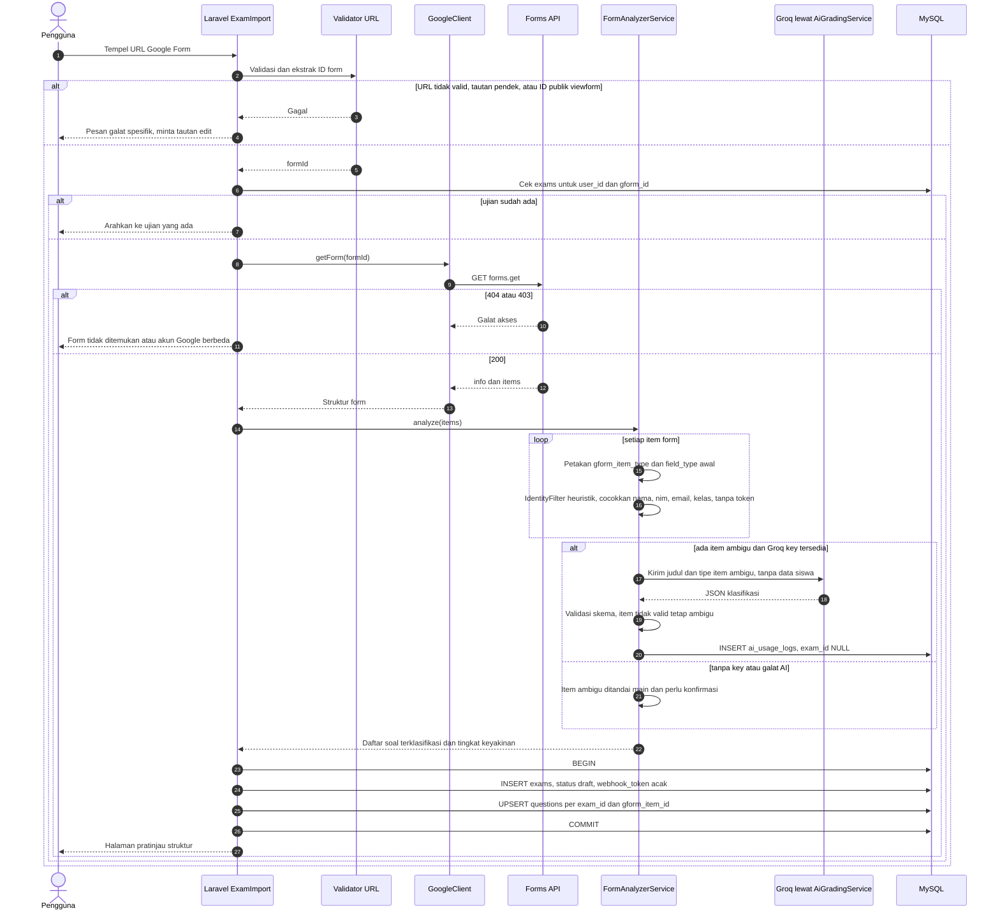
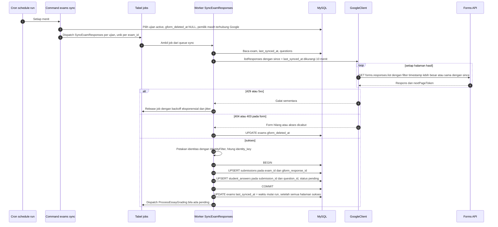
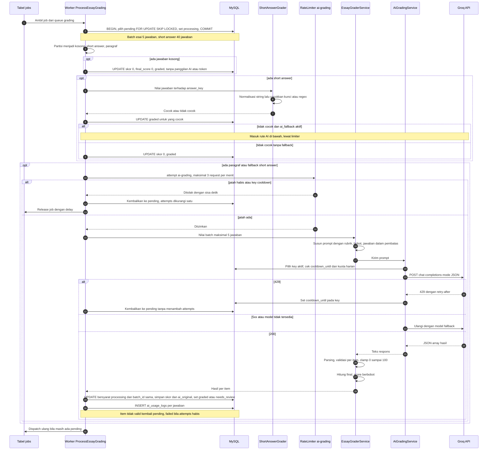
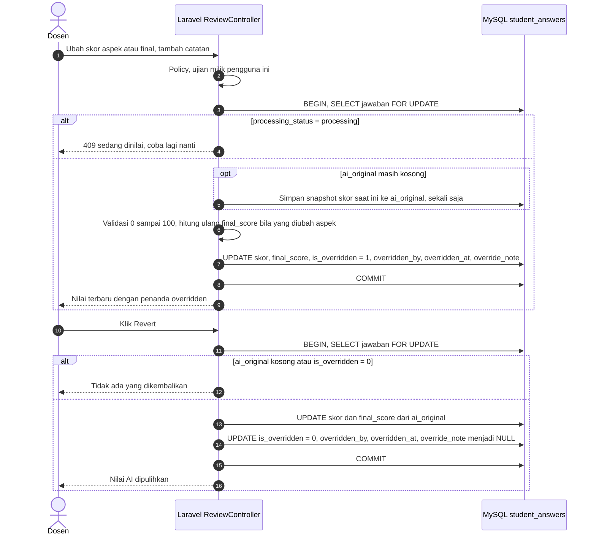

# Alur Pengguna dan Alur Teknis: Essay Grader

*Dokumentasi User Flow dan Technical Workflow seluruh siklus hidup interaksi aplikasi. Disusun oleh Senior Technical Systems Analyst. Versi 1.0 (Draft), turunan dari PRD, System Architecture Document, dan Spesifikasi Skema Database.*

## 1. Cara Membaca Dokumen

Dokumen ini memuat delapan diagram Mermaid: satu *flowchart* perjalanan pengguna (Bagian 2) dan tujuh *sequence diagram* untuk alur teknis (Bagian 3 sampai 6). Setiap diagram diikuti aturan dan kasus galat yang tidak muat di gambar. Nama kelas, tabel, dan kolom mengikuti dokumen sebelumnya; selisih yang ditemukan dikumpulkan di Bagian 7.

## 2. End-to-End User Journey

Perjalanan pendidik dari login hingga unduh Excel terbagi empat fase. Fase 3 berjalan otomatis tanpa tindakan pengguna; garis putus-putus menandai jalur berulang atau pengecualian.

```mermaid
flowchart TD
    A(["Mulai"]) --> B{"Sudah punya akun?"}
    B -->|"Belum"| C["Daftar: email dan password, atau Google"]
    B -->|"Sudah"| D["Login"]
    C --> E["Dashboard"]
    D --> E

    subgraph F1["Fase 1: Koneksi"]
        G{"Google sudah terhubung?"}
        H["Klik Hubungkan Google, setujui izin read-only"]
        I{"Izin forms diberikan?"}
        J["Simpan Groq API key, divalidasi otomatis"]
    end
    E --> G
    G -->|"Belum"| H
    G -->|"Sudah"| J
    H --> I
    I -->|"Tidak"| H
    I -->|"Ya"| J

    subgraph F2["Fase 2: Impor dan konfigurasi"]
        K["Tempel URL Google Form"]
        L{"URL valid dan form dapat diakses?"}
        M["Analisis struktur otomatis: heuristik, AI untuk yang ambigu"]
        N["Pratinjau: koreksi peran field"]
        O["Konfigurasi rubrik: kunci jawaban, bobot, mode nilai"]
        P{"Konfigurasi valid? Bobot total 100 persen"}
    end
    J --> K
    K --> L
    L -->|"Tidak"| K
    L -->|"Ya"| M
    M --> N
    N --> O
    O --> P
    P -->|"Belum"| O
    P -->|"Valid"| Q["Aktifkan ujian: status active"]

    subgraph F3["Fase 3: Otomatis di latar belakang"]
        R["Scheduler tiap menit memicu sinkronisasi"]
        S["Jawaban baru disimpan, status pending"]
        T["Worker menilai: kosong 0, short answer, paragraf AI"]
        U{"Hasil penilaian"}
    end
    Q --> R
    R --> S
    S --> T
    T --> U
    U -.->|"jawaban baru dari siswa"| R
    R -.->|"token Google dicabut"| AF["Banner: hubungkan ulang Google"]
    AF -.-> H

    subgraph F4["Fase 4: Reviu dan laporan"]
        V["Dosen meninjau hasil dan antrean review"]
        W{"Perlu koreksi?"}
        X["Override skor atau beri catatan"]
        Y{"Batalkan perubahan?"}
        Z["Revert ke nilai AI"]
        AA["Lihat laporan: statistik dan grafik sebaran"]
        AB["Unduh Excel"]
    end
    U -->|"graded atau needs_review"| V
    U -.->|"failed: Coba lagi"| T
    V --> W
    W -->|"Ya"| X
    W -->|"Tidak"| AA
    X --> Y
    Y -->|"Ya"| Z
    Z --> V
    Y -->|"Tidak"| AA
    AA --> AB
    AB --> AC(["Selesai"])
```



## 3. Integrasi Google OAuth dan Izin Form

Hubungkan Google meminta izin *read-only* terpisah dari login: `forms.body.readonly` dan `forms.responses.readonly`. Login dengan Google hanya memakai identitas dasar (`openid email profile`), sehingga pengguna yang hanya ingin masuk tidak diminta izin Forms (incremental authorization).

### 3.1 Handshake Authorization Code Grant



`access_type=offline` dan `prompt=consent` diperlukan agar Google selalu mengembalikan refresh token. Pertukaran `code` terjadi di server sehingga `client_secret` tidak pernah sampai ke browser. Jika pengguna menghapus centang salah satu scope di layar persetujuan, hasilnya diperlakukan sebagai penolakan: token tidak disimpan dan pengguna diminta mengulang dengan penjelasan izin mana yang kurang.

### 3.2 Pemakaian Token, Refresh, dan Pencabutan Izin



### 3.3 Kondisi Galat OAuth

| Kondisi | Cara terdeteksi | Tindakan sistem | Tindakan pengguna |
| --- | --- | --- | --- |
| Pengguna mencabut akses di Google Account settings | Tidak ada notifikasi ke aplikasi; terdeteksi saat refresh (`invalid_grant`) atau API menjawab 401 | Kosongkan kedua token, jeda sinkronisasi, kirim banner dan email | Klik Hubungkan Google lagi |
| Refresh token kedaluwarsa (tidak dipakai lama, atau aplikasi OAuth berstatus Testing) | `invalid_grant` saat refresh | Sama seperti di atas | Hubungkan ulang |
| Salah satu scope dicabut | 403 dengan pesan izin tidak cukup | Jeda ujian terdampak, minta persetujuan ulang | Setujui scope yang kurang |
| Pengguna memutus koneksi dari aplikasi | Aksi eksplisit | Panggil endpoint revoke Google, lalu kosongkan token | Tidak ada |
| Gangguan jaringan atau 5xx Google | Exception transport | Backoff dan percobaan ulang job; token tidak disentuh | Tidak ada |

Status koneksi Google **diturunkan** dari token yang kosong, tanpa kolom status baru. Token tidak pernah ditulis ke log.

## 4. Ingesti dan Auto-Klasifikasi Form



### 4.1 Validasi dan Ekstraksi ID Form

API Forms hanya menerima **ID form dari tautan edit**, bukan ID publik pada tautan `viewform`. Pola validator:

```text
^https://docs\.google\.com/forms/d/(?!e/)([A-Za-z0-9_-]{20,})(?:/[^?#]*)?(?:[?#].*)?$
```

| Masukan | Hasil |
| --- | --- |
| `https://docs.google.com/forms/d/ID/edit` | Diterima; ID = grup tangkapan 1 |
| `.../forms/d/ID/edit?usp=sharing` | Diterima |
| `.../forms/d/e/ID/viewform` | Ditolak: ID publik tidak dapat dipakai API; minta tautan edit |
| `https://forms.gle/...` | Ditolak: tautan pendek tidak diikuti untuk menghindari risiko redirect/SSRF |
| Host selain `docs.google.com` | Ditolak |

### 4.2 Pemetaan Tipe Item dan Heuristik IdentityFilter

| Item Google | Hasil awal |
| --- | --- |
| Pertanyaan teks pendek | Kandidat `identity` atau `main`, ditentukan heuristik |
| Pertanyaan paragraf | `main`, `scoring`; tidak pernah `identity` |
| Pilihan, skala, tanggal, waktu | `main` dengan `non_scoring` (tampil di ekspor, tidak dinilai) |
| Teks, gambar, video | `stimulus` |
| Pemisah halaman | Dilewati, tidak disimpan |

Judul dinormalisasi (huruf kecil, tanda baca dan spasi ganda dibuang) lalu dicocokkan:

| Kata kunci | Keputusan |
| --- | --- |
| nama, nama lengkap, name | `identity` (nama) |
| nim, npm, nis, nomor induk, student id | `identity` (ID siswa) |
| email, surel | `identity` (email) |
| kelas, class, rombel | `identity` (kelas) |
| identitas, data diri, kode, nomor, asal, angkatan, absen | Ambigu: diteruskan ke tahap AI |
| Tidak cocok | `main` (teks pendek di posisi awal form dianggap ambigu) |

Tahap AI hanya mengirim judul, deskripsi, dan tipe item, tidak pernah jawaban atau data siswa, dan tidak dijalankan di dalam transaksi database karena lambat. Hasil dengan keyakinan rendah tetap ditampilkan di pratinjau agar dikonfirmasi pendidik.

## 5. Sinkronisasi dan Penilaian Background Worker

### 5.1 Sinkronisasi Respons



| Aturan | Perilaku |
| --- | --- |
| Parameter `since` | Nilai internal `last_synced_at` dikurangi 10 menit, diterjemahkan ke parameter `filter` Google berbentuk `timestamp >= since` (RFC 3339 UTC). Sinkronisasi pertama tanpa filter |
| Tumpang tindih 10 menit | Menutup respons yang tercatat terlambat di sisi Google, selisih jam, dan sinkronisasi sebelumnya yang gagal. Respons yang terbaca ulang tidak berbahaya karena upsert idempoten |
| Pemajuan penanda | `last_synced_at` diisi **waktu mulai** run (bukan selesai) dan hanya bila seluruh halaman tersimpan, sehingga tidak ada celah |
| Jawaban tidak berubah | Baris dibiarkan; skor yang sudah ada tidak ditimpa |
| Jawaban diubah siswa | Kembali `pending` dan dinilai ulang; bila sudah di-override manual, ditandai `needs_review` |
| Duplikasi logis | Pencarian (`exam_id`, `identity_key`); respons baru dengan identitas sama mengikuti kebijakan pengiriman ulang |
| Field identity | Masuk ke `submissions.identity`, bukan `student_answers` |
| Soal `non_scoring` | Disimpan berstatus `graded` tanpa skor dan tidak pernah masuk antrean |
| Pencegahan paralel | Job unik per `exam_id`; satu ujian tidak disinkron dua kali bersamaan |

### 5.2 Eksekusi ProcessEssayGrading



Nilai akhir dihitung aplikasi, bukan model, dari tiga parameter dengan bobot per soal (`grading_config`, default 50, 30, 20) dan total bobot 1,00:

```latex
final = w_c \cdot s_{content} + w_l \cdot s_{logic} + w_s \cdot s_{structure}
```

| Jalur | Kondisi | Perlakuan | Token |
| --- | --- | --- | --- |
| Kosong | `answer_text` NULL atau hanya spasi | Semua skor 0, `graded`, sumber aturan | 0 |
| Short answer | Soal `main`, `scoring`, teks pendek | Normalisasi (huruf kecil, trim, buang tanda baca dan spasi ganda), cocok kunci atau regex memberi skor penuh, selain itu 0 atau fallback AI | 0, kecuali fallback |
| Paragraf | Soal paragraf | Batch maksimal 5, dikelompokkan per soal agar rubrik sama, satu request Groq | Ya |

Pemeriksaan limiter `ai-grading` berlaku pada setiap panggilan Groq (paragraf dan fallback short answer). Pekerjaan tanpa AI (jawaban kosong dan pencocokan deterministik) tidak pernah menunggu limiter.

## 6. Human Override dan Revert



`ai_original` menyimpan potret yang tidak pernah ditimpa setelah terisi:

```json
{"source": "ai", "model": "nama-model", "scores": {"content": 80, "logic": 70, "structure": 90}, "final_score": 79, "reasons": {"content": "...", "logic": "...", "structure": "..."}, "captured_at": "2026-11-18T09:00:00Z"}
```

- **Sumber snapshot.** Normalnya `ai_original` terisi saat penilaian otomatis (`source` = `ai` atau `rule`). Snapshot saat override pertama hanya jaring pengaman bagi baris yang belum punya potret (`source` = `snapshot`).
- **Edit aspek vs final.** Mengubah satu aspek memicu perhitungan ulang `final_score` berbobot; mengubah `final_score` langsung diperbolehkan dan tidak mengubah aspek.
- **Konflik dengan worker.** Kunci baris dan penolakan 409 saat `processing` mencegah override tertimpa penilaian yang sedang berjalan; pembaruan bersyarat worker menjaga arah sebaliknya.
- **Jejak.** Hanya override terakhir yang tercatat di baris; riwayat penuh membutuhkan tabel audit (lihat dokumen skema, Bagian 7).

## 7. Keselarasan dengan Dokumen Sebelumnya dan Hal Terbuka

1. **Nama kolom token.** Spesifikasi alur memakai `google_token`, skema memakai `google_access_token`. Perlu satu nama baku.
2. **Status koneksi Google.** Diturunkan dari token NULL. Bila UI perlu menampilkan sejak kapan dan mengapa terputus, tambahkan kolom (misalnya `google_disconnected_at`).
3. **Fallback AI pada short answer.** PRD dan SAD menyebut short answer murni deterministik. Dokumen ini menambah fallback AI per soal (`grading_config.ai_fallback`, usulan default mati karena menambah biaya token); PRD dan SAD perlu diperbarui.
4. **Tahap kedua IdentityFilter.** SAD menggambarkan validasi nilai pada sampel jawaban, dokumen ini memakai Groq untuk item ambigu. Keduanya dapat digabung (nilai sampel setelah sinkronisasi pertama), perlu keputusan.
5. **Parameter `since`.** Google tidak memiliki parameter `since`; yang dipakai `filter` `timestamp >= ...`. `since` adalah nama internal.
6. **Aplikasi OAuth berstatus Testing.** Refresh token kedaluwarsa singkat; sebelum produksi aplikasi harus dipublikasikan dan lolos verifikasi scope (PRD R-09).
7. **Urutan limiter.** Dokumen ini menempatkan limiter tepat sebelum panggilan Groq, bukan di awal job, agar pekerjaan nol-token tidak tertahan.

---

*Akhir dokumen Alur Pengguna dan Alur Teknis v1.0.*
