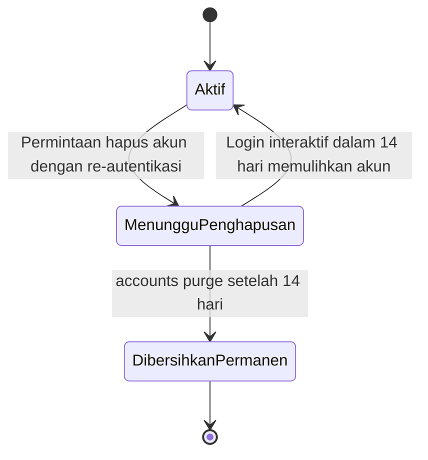

# Kebijakan Keamanan, Privasi Data, dan Tata Kelola Akun: Essay Grader

*Security Policy dan Compliance Guide untuk aplikasi Essay Grader. Disusun oleh Application Security Engineer dan Compliance Officer. Versi 1.0 (Draft), turunan dari PRD, SAD, Skema Database, Alur Teknis, dan Spesifikasi Grading Engine.*

## 1. Ruang Lingkup, Peran, dan Klasifikasi Data

> **Catatan.** Dokumen ini adalah kebijakan teknis dan panduan kepatuhan, bukan nasihat hukum. Penafsiran GDPR dan UU Pelindungan Data Pribadi (UU PDP, UU No. 27 Tahun 2022), peran pengendali dan prosesor, serta tenggat pemberitahuan insiden perlu ditinjau penasihat hukum sebelum produksi. Nama kelas, rute, dan perintah mengikuti brief proyek.

| Peran | Hak akses |
| --- | --- |
| Pengajar | Hanya data ujian miliknya (`user_id`) |
| Admin (`is_admin`) | Rute `/admin/*` dan pengelolaan key sistem; **tidak** otomatis dapat membaca isi ujian pengajar lain |
| Sistem (worker dan scheduler) | Berjalan tanpa sesi pengguna; wajib membawa ID pemilik secara eksplisit |
| Siswa | Tidak memiliki akun dan tidak mengakses aplikasi; datanya masuk lewat Google Form |

| Data | Klasifikasi | Perlindungan utama |
| --- | --- | --- |
| Token Google, API key Groq | Rahasia | Enkripsi aplikasi, tidak pernah ditampilkan atau di-log |
| Password | Rahasia | Hash satu arah |
| Identitas siswa, jawaban, nilai | Data pribadi | Isolasi tenant, TLS, enkripsi disk, retensi |
| Konten ujian (soal, kunci jawaban) | Rahasia bisnis pengajar | Isolasi tenant |
| Log pemakaian AI | Metadata | Tanpa isi prompt atau jawaban |

## 2. Model Ancaman dan Keamanan Aplikasi

### 2.1 Ancaman Utama

| Aktor | Ancaman | Mitigasi utama |
| --- | --- | --- |
| Pengguna lain (tenant) | Membaca atau mengubah ujian dan nilai pengajar lain (IDOR) | Policy kepemilikan, route binding ter-scope, uji otomatis (Bagian 4) |
| Penyerang eksternal | Brute force dan credential stuffing, email bombing | Rate limiting, respons generik, kebijakan password (Bagian 2.5) |
| Siswa | Prompt injection dan jailbreak untuk menaikkan nilai | Pertahanan berlapis (Bagian 2.4) |
| Siswa atau pembuat form | XSS tersimpan lewat jawaban, judul form, atau alasan penilaian AI | Escape keluaran, CSP |
| Penyerang dengan akses DB atau backup | Mencuri token dan API key | Enkripsi aplikasi dengan `APP_KEY` terpisah dari backup |
| Pihak yang memiliki URL webhook | Memicu sinkronisasi tanpa izin | Token acak, perbandingan waktu-konstan, rate limit |
| Pengguna berniat buruk | Memakai fitur tes key sebagai oracle validasi API key curian, atau menguras kuota | Rate limit 6 per menit, wajib login, audit |
| Insider atau akun admin terambil alih | Penyalahgunaan rute admin | `EnsureAdmin`, `is_admin` tidak bisa di-mass-assign, audit, usulan 2FA admin |

### 2.2 Pemetaan OWASP Top 10 (edisi 2021)

Pemetaan perlu diperbarui bila organisasi mengikuti edisi OWASP yang lebih baru.

| Kategori | Penerapan pada Essay Grader |
| --- | --- |
| A01 Broken Access Control | `ExamPolicy`, route binding ter-scope, `EnsureAdmin`, tanpa akses lintas tenant |
| A02 Cryptographic Failures | Enkripsi at-rest field rahasia, hash password, TLS 1.2+, cookie `Secure` |
| A03 Injection | Eloquent dan query binding, validasi masukan, pertahanan prompt injection |
| A04 Insecure Design | Threat modeling ini, masa tenggang 14 hari, scope Google read-only, minimisasi data ke LLM |
| A05 Security Misconfiguration | `APP_DEBUG=false`, `.env` di luar repositori, header keamanan, hak akses DB minimum |
| A06 Vulnerable Components | `composer audit` di CI, pembaruan dependensi terjadwal, file kunci (`composer.lock`) |
| A07 Identification and Authentication Failures | Rate limit, password kuat dan hash modern, regenerasi sesi, respons generik |
| A08 Software and Data Integrity Failures | CI terkontrol, validasi ketat keluaran LLM sebelum dipakai, token webhook |
| A09 Logging and Monitoring Failures | Log audit peristiwa keamanan (Bagian 7) |
| A10 SSRF | Server hanya memanggil host tetap (Google dan Groq); URL form divalidasi ke `docs.google.com`, tautan pendek ditolak |

### 2.3 Kontrol Laravel yang Diwajibkan

**CSRF.**

- Semua rute `web` melewati `VerifyCsrfToken`; setiap form memakai `@csrf`, permintaan AJAX membawa `X-CSRF-TOKEN` atau `X-XSRF-TOKEN`.
- Pengecualian hanya untuk endpoint webhook, yang diautentikasi token rahasia (dan disarankan tanda tangan HMAC); callback OAuth dilindungi parameter `state`.
- Cookie sesi `SameSite=Lax`, `HttpOnly`, `Secure`; logout memakai `POST`.

**Mass Assignment.**

- Setiap model mendeklarasikan `$guarded` atau `$fillable`. Disarankan `$fillable` sebagai *allowlist* karena kolom baru otomatis terlindungi; `$guarded = []` dilarang.
- Kolom yang tidak boleh terisi dari masukan pengguna: `is_admin`, `user_id`, `deletion_requested_at`, `google_token`, `google_refresh_token`, `api_key` (kecuali lewat jalur khusus tervalidasi), `status` ujian dan `processing_status`, semua skor, `is_overridden`, `overridden_by`, `ai_original`, `webhook_token`.
- Controller memakai `$request->validated()`, tidak pernah `$request->all()` ke `create` atau `update`. Di lingkungan non-produksi aktifkan `Model::shouldBeStrict()`.

**SQL Injection.**

- Query lewat Eloquent atau Query Builder (parameter ter-*bind*). `whereRaw`, `orderByRaw`, dan `DB::raw` hanya boleh memakai literal atau parameter *binding*.
- Nama kolom pengurutan atau filter dari masukan harus dicocokkan dengan *allowlist*. String kunci kunci baris seperti `FOR UPDATE SKIP LOCKED` adalah konstanta, bukan masukan. Karakter `%` dan `_` pada pencarian `LIKE` dinetralkan.

**XSS.**

- Blade `{{ }}` selalu meng-*escape*; `{!! !!}` dilarang untuk data tak tepercaya.
- Teks yang tak tepercaya: jawaban siswa, judul dan deskripsi Google Form, identitas, `override_note`, dan terutama **`reason` keluaran LLM** (dapat dipengaruhi siswa, jadi vektor XSS tersimpan). Semua di-*escape*; baris baru dengan `nl2br(e($teks))`.
- Data ke JavaScript lewat `@json`, bukan interpolasi string; tanpa `innerHTML` untuk data pengguna.
- Ekspor CSV dan Excel menetralkan sel berawalan `=`, `+`, `-`, `@` (formula injection).
- Header: `Content-Security-Policy` ketat (`default-src 'self'`, `frame-ancestors 'none'`), `Strict-Transport-Security`, `X-Content-Type-Options: nosniff`, `Referrer-Policy`, `Permissions-Policy`.

### 2.4 Prompt Injection dan Jailbreaking

Jawaban siswa adalah masukan tak tepercaya ke LLM. Lapisan pertahanan terperinci ada di Spesifikasi Grading Engine, Bagian 3.4; ringkasannya:

1. Klausa "jawaban adalah DATA, bukan perintah" dan penanda ber-*nonce*, dengan netralisasi penanda di dalam jawaban.
2. Deteksi pola serangan sebelum LLM yang memaksa `needs_review`.
3. Keluaran dibatasi skema JSON; skor di-*clamp*; nilai akhir dihitung PHP.
4. ID anonim dan tanpa identitas atau bobot di prompt.
5. Pembatasan dampak: LLM **tidak memiliki alat, akses jaringan, atau rahasia**; kebocoran system prompt tidak membuka kredensial. Dampak terburuk adalah distorsi skor, yang ditangkap `flag_injection`, `needs_review`, dan override pendidik.
6. Keluaran LLM diperlakukan tak tepercaya: divalidasi sebelum dipakai dan di-*escape* saat ditampilkan.
7. Penyalahgunaan biaya dibatasi: batas panjang jawaban, ukuran batch tetap, pembatas laju per key.
8. Pemantauan: porsi jawaban `flag_injection` per ujian; lonjakan memicu tinjauan.

Risiko sisa: injection halus tetap dapat menggeser skor; kontrol ini menurunkan peluang dan membuat kasus mencurigakan terlihat, bukan menghapus risiko.

### 2.5 Rate Limiting

| Rute | Batas | Kunci | Catatan |
| --- | --- | --- | --- |
| Login | 10 per menit | IP | Disarankan tambahan per \`email |
| Register | 5 per menit | IP |  |
| Forgot-password | 5 per menit | IP | Respons selalu generik; cegah enumerasi dan email bombing |
| AI test (uji key Groq) | 6 per menit | ID pengguna | Wajib login; mencegah oracle validasi key |

```php
RateLimiter::for('login', fn (Request $r) => Limit::perMinute(10)->by($r->ip()));
RateLimiter::for('register', fn (Request $r) => Limit::perMinute(5)->by($r->ip()));
RateLimiter::for('forgot-password', fn (Request $r) => Limit::perMinute(5)->by($r->ip()));
RateLimiter::for('ai-test', fn (Request $r) => Limit::perMinute(6)->by($r->user()?->id ?: $r->ip()));
// rute: ->middleware('throttle:login'), dan seterusnya
```

Pelanggaran mengembalikan 429 dengan header `Retry-After` dan dicatat. Di belakang *reverse proxy*, `TrustProxies` harus dikonfigurasi benar: bila tidak, semua pengguna terlihat berasal dari satu IP (terkunci massal) atau penyerang dapat memalsukan `X-Forwarded-For`. Penyimpanan limiter memakai cache bersama (database atau Redis) agar berlaku lintas proses.

## 3. Kriptografi dan Penyimpanan Data Sensitif

### 3.1 Enkripsi At-Rest

| Field | Tabel | Mekanisme |
| --- | --- | --- |
| `google_token` (di skema: `google_access_token`) | `users` | Laravel Encryption (`encrypted` cast), AES-256-CBC |
| `google_refresh_token` | `users` | Sama |
| `api_key` | `ai_api_keys` (model `AiApiKey`) | Sama |

- Laravel Encryption memakai AES-256-CBC dengan IV acak per nilai dan MAC HMAC-SHA-256 (*encrypt-then-MAC*), sehingga ciphertext yang diubah ditolak saat dekripsi. `APP_KEY` berukuran 32 byte.
- Ciphertext lebih panjang dari plaintext, maka kolom bertipe `TEXT`. Kolom terenkripsi tidak dapat dicari atau diindeks; pencarian memakai kolom lain.
- `APP_KEY` disimpan di *secret manager* atau variabel lingkungan server, **tidak** di repositori dan tidak di backup yang sama dengan dump database, sehingga dump yang bocor tidak berarti rahasia terbuka. Kehilangan `APP_KEY` berarti semua token dan key harus dihubungkan ulang.
- Rotasi: gunakan dukungan kunci sebelumnya (`APP_PREVIOUS_KEYS`) lalu jalankan perintah enkripsi ulang seluruh baris; rotasi wajib dilakukan setelah dugaan kebocoran.
- Nilai rahasia tidak pernah masuk log, pesan galat, atau respons API; key hanya tampil tersamarkan (empat karakter terakhir).

**Keputusan terdokumentasi:** teks jawaban dan identitas siswa **tidak** dienkripsi di tingkat aplikasi karena akan memblokir pencarian, laporan, dan indeks. Perlindungannya: enkripsi disk atau volume, TLS ke database, hak akses DB minimum, backup terenkripsi. Risikonya adalah akses langsung ke DB membuka data tersebut.

**Usulan:** `exams.webhook_token` disimpan sebagai hash SHA-256 (pencarian lewat hash, token ditampilkan sekali saat dibuat atau dirotasi), bukan plaintext seperti pada skema saat ini.

### 3.2 Hashing Password

- Algoritma: `bcrypt` (biaya minimal 12) atau `argon2id` lewat konfigurasi `hashing`; parameter mengikuti rekomendasi OWASP Password Storage Cheat Sheet terkini. `Hash::needsRehash` dipanggil saat login untuk meningkatkan hash lama.
- `users.password` NULL untuk akun yang hanya memakai Google.
- Kebijakan password: panjang minimal 8 (disarankan 12), diperiksa terhadap daftar password bocor (`Password::min(8)->uncompromised()`), tanpa aturan komposisi yang memaksa.
- Sesi diregenerasi saat login; logout menginvalidasi sesi; token reset password di-*hash*, kedaluwarsa singkat, dan sekali pakai.

### 3.3 Transport dan Infrastruktur

TLS 1.2+ untuk semua trafik dan koneksi database; HSTS; `APP_DEBUG=false` dan halaman galat tanpa jejak tumpukan; pengguna DB aplikasi tidak memiliki hak `DROP` atau `ALTER` (migrasi memakai akun terpisah); backup terenkripsi dengan retensi terdefinisi (usulan 35 hari).

## 4. Multi-Tenancy dan Otorisasi Data

### 4.1 Isolasi Horizontal

Prinsip: **setiap akses data ujian harus terikat pada pemilik**. Aturan inti: `$exam->user_id === auth()->id()`, diterapkan lewat Policy, bukan pemeriksaan ad hoc di controller.

| Sumber daya | Jalur kepemilikan | Penegakan |
| --- | --- | --- |
| `exams` | `user_id` langsung | `ExamPolicy`; query lewat `$user->exams()` |
| `questions`, `submissions` | `exam.user_id` | Route binding ter-scope di bawah `exams`, plus otorisasi ujian induk |
| `student_answers` | `submission.exam.user_id` | Otorisasi lewat jalur penuh; pastikan `question.exam_id` sama dengan `submission.exam_id` |
| `ai_api_keys` | `user_id` langsung; NULL = key sistem | Key sistem hanya admin |
| `ai_usage_logs` | `user_id` | Hanya pemilik; agregat global hanya admin |
| `jobs`, `failed_jobs` | Bukan data tenant (payload hanya ID) | Hanya admin |

```php
public function view(User $user, Exam $exam): bool
{
    return $exam->user_id === $user->id;
}
```

- **Route model binding ter-scope** (`scopeBindings()`) memastikan `/exams/{exam}/questions/{question}` tidak membuka soal milik ujian lain.
- **Hati-hati dengan global scope berbasis `auth()`:** di worker atau perintah Artisan `auth()->id()` bernilai NULL; scope yang hanya aktif `when(auth()->check())` akan **mematikan isolasi** secara senyap. Job dan perintah wajib membawa `user_id` dan `exam_id` eksplisit dan memverifikasi kepemilikan. `withoutGlobalScopes()` hanya pada kode sistem yang jelas.
- Perbandingan ID memakai tipe yang konsisten (cast integer), agar `===` tidak gagal diam-diam atau lolos karena pembandingan longgar.
- **Uji otomatis wajib:** untuk setiap rute bernama ID, pengguna B mencoba mengakses sumber daya pengguna A (harus 403 atau 404). Dijalankan di CI.
- Endpoint webhook memetakan token ke satu ujian dan tidak mengembalikan data ujian.

### 4.2 Middleware EnsureAdmin

```php
public function handle(Request $request, Closure $next)
{
    abort_unless($request->user()?->is_admin === true, 403);
    return $next($request);
}
```

Dipasang pada grup `/admin/*` bersama `auth` dan `verified`, termasuk halaman **mail tester**. Ketentuan: pengirim tes hanya ke alamat admin yang sedang login (bukan penerima bebas, mencegah penyalahgunaan sebagai relai spam) dan di-*rate limit*; `is_admin` hanya dapat diubah lewat perintah Artisan atau DB, tidak lewat formulir; setiap tindakan admin dicatat; usulan 2FA dan re-autentikasi untuk aksi sensitif; admin terakhir tidak boleh dihapus atau diturunkan.

## 5. Kepatuhan Privasi dan Siklus Hidup Akun

### 5.1 Peran dan Hak Subjek Data

Secara umum **pengajar** menentukan tujuan pemrosesan data siswa dan operator aplikasi memprosesnya atas nama pengajar; untuk data akun pengajar, operator bertindak sebagai pengendali sendiri. Klasifikasi ini harus dikonfirmasi secara hukum. Sub-pemroses: Google (sumber data) dan Groq (penilaian). Transfer lintas negara dan perjanjian pemrosesan data dengan penyedia perlu ditinjau. Minimisasi: hanya teks jawaban yang dikirim ke Groq, tanpa identitas.

| Hak | Fitur |
| --- | --- |
| Akses dan portabilitas | `/akun/ekspor` (Bagian 5.2) |
| Perbaikan | Edit profil; koreksi nilai lewat override |
| Penghapusan | Masa tenggang 14 hari dan `accounts:purge` (5.3 dan 5.4); hapus ujian; `exams:prune` |
| Pembatasan dan penarikan persetujuan | Putuskan koneksi Google (cabut token), hapus API key, tutup ujian |
| Pemberitahuan pelanggaran | Prosedur insiden (Bagian 7) |
| Hak siswa (tanpa akun) | Melalui pengajar. **Celah:** perlu fitur hapus satu `submission` atau siswa per ujian |

### 5.2 Ekspor Data: /akun/ekspor

`AccountController::export` menghasilkan satu berkas JSON terstruktur berisi profil, daftar ujian, pertanyaan, pengiriman, dan riwayat nilai milik pengguna.

```json
{
  "meta": {"generated_at": "...", "format_version": 1},
  "profile": {"name": "...", "email": "...", "created_at": "...", "google_connected": true},
  "exams": [{
    "title": "...", "status": "closed",
    "questions": [{"title": "...", "field_type": "main", "grading_mode": "scoring", "answer_key": "..."}],
    "submissions": [{"identity": {}, "submitted_at": "...", "answers": [{
      "answer_text": "...", "content_score": 80, "logic_score": 70, "structure_score": 90,
      "final_score": 79, "is_overridden": false, "override_note": null, "ai_original": {}
    }]}]
  }],
  "ai_usage_summary": {}
}
```

| Aturan | Ketentuan |
| --- | --- |
| Dikecualikan | Hash password, token Google, nilai API key (termasuk bentuk terenkripsi), `webhook_token`, `remember_token`. `raw_payload` dikecualikan secara bawaan (redundan dan besar) |
| Otorisasi | Hanya pemilik; wajib konfirmasi ulang (password atau Google) karena data sensitif |
| Batas | Maksimal 3 ekspor per jam per pengguna (usulan) |
| Implementasi | `streamDownload` dengan `lazyById()` agar memori tetap datar; `Cache-Control: no-store` |
| Akun besar | Di atas ambang baris (usulan 50.000 jawaban) dijalankan sebagai job, hasil dikirim lewat tautan bertanda tangan berumur pendek |
| Audit | Setiap ekspor dicatat (waktu, pengguna, ukuran) |

### 5.3 Hak Penghapusan: Masa Tenggang 14 Hari



- **Permintaan:** pengguna mengonfirmasi dengan password atau autentikasi ulang Google; sistem mengisi `deletion_requested_at` dan mengirim email konfirmasi (hari ke-0) serta pengingat (hari ke-13). Periode bawaan 14 hari dibaca dari konfigurasi (`ACCOUNT_DELETION_GRACE_DAYS`).
- **Selama masa tenggang:** sinkronisasi dan penilaian dijeda (ujian pemilik dikecualikan dari scheduler), token tidak dipakai, data tidak diubah dan belum dihapus.
- **Pemulihan otomatis:** bila pengguna berhasil login dalam masa tenggang, `deletion_requested_at` dikosongkan, banner pemulihan tampil, dan email pemberitahuan dikirim. Usulan: hanya login interaktif (password atau OAuth) yang memulihkan, bukan pemulihan sesi lewat *remember token*, agar akun tidak batal dihapus tanpa disadari.
- **Perlindungan penyalahgunaan:** permintaan hapus memerlukan re-autentikasi dan selalu diberitahukan lewat email, sehingga pembajak sesi tidak bisa menghapus akun secara senyap.

### 5.4 Perintah accounts:purge

Dijadwalkan harian di jam sepi, tanpa tumpang tindih:

```php
Schedule::command('accounts:purge')->dailyAt('02:00')->withoutOverlapping()->onOneServer();
```

| Langkah | Tindakan |
| --- | --- |
| 1 | Pilih pengguna dengan `deletion_requested_at` lebih lama dari ambang masa tenggang; dukung `--dry-run` dan `--user=ID` |
| 2 | Per pengguna, kunci baris (`FOR UPDATE`) dan **periksa ulang** bahwa permintaan masih berlaku (menutup balapan dengan pemulihan lewat login) |
| 3 | Putuskan koneksi Google: `$google->disconnect()` mencabut token di Google (*best effort*: kegagalan dicatat dan tidak menghentikan penghapusan) lalu mengosongkan kolom token |
| 4 | Hapus data **dari bawah ke atas dalam potongan**: `student_answers`, `submissions`, `questions`, `exams`, `ai_api_keys`, `ai_usage_logs`; hindari satu transaksi raksasa. Aturan cascade FK menjadi jaring pengaman |
| 5 | Bersihkan sisa: baris `sessions` dan token reset password milik pengguna, entri cache (cooldown), berkas ekspor sementara, dan job tertunda (job memakai `deleteWhenMissingModels` agar gugur wajar) |
| 6 | Kirim email konfirmasi penghapusan (alamat masih dipegang di memori), lalu hapus baris `users` |
| 7 | Catat peristiwa audit **tanpa data pribadi** (hash ID, waktu, jumlah baris per tabel) |

Perintah bersifat idempoten dan dapat dilanjutkan bila terputus. Data tetap ada di backup sampai rotasi (usulan 35 hari); prosedur *restore* wajib menerapkan ulang penghapusan yang tercatat sebelum data dipakai kembali. Admin terakhir dikecualikan dari purge otomatis.

## 6. Kebijakan Retensi: exams:prune

Perintah `exams:prune` menghapus ujian tidak aktif yang melewati `RETENTION_DAYS`:

```php
Schedule::command('exams:prune')->dailyAt('03:00')->withoutOverlapping()->onOneServer();
```

| Aspek | Ketentuan |
| --- | --- |
| Konfigurasi | `RETENTION_DAYS`. Bila kosong atau 0, fitur **nonaktif** (bawaan aman, tidak ada penghapusan mengejutkan). Nilai ditetapkan institusi, mis. 365 |
| Definisi tidak aktif | Status `draft` atau `closed`, dan aktivitas terakhir lebih lama dari ambang. Aktivitas terakhir = nilai terbesar dari `updated_at` dan `last_synced_at`. Ujian `active` tidak pernah dihapus |
| Pengaman | Lewati ujian yang masih memiliki jawaban `processing`; dukung `--dry-run`, `--days=` dan `--exam=`; potongan per ujian bawah ke atas seperti purge |
| Pemberitahuan | Email peringatan ke pemilik sebelum penghapusan (usulan 14 hari) dengan tautan ekspor |
| Pengecualian | Usulan kolom `retention_hold` (†) agar pengajar dapat menahan ujian tertentu |
| Audit | Hanya jumlah ujian dan baris yang dihapus per eksekusi, tanpa isi |

Kolom pendukung (†, usulan): `exams.prune_notified_at` untuk menandai peringatan sudah dikirim dan `exams.retention_hold`.

| Data | Retensi | Mekanisme |
| --- | --- | --- |
| Ujian tidak aktif | `RETENTION_DAYS` | `exams:prune` |
| Akun menunggu penghapusan | 14 hari | `accounts:purge` |
| `submissions.raw_payload` | Dikosongkan sebagai minimisasi setelah ujian ditutup (usulan 30 hari) | Tahap awal `exams:prune` |
| `ai_usage_logs` | Usulan 180 hari, lalu agregasi | Pembersihan terjadwal |
| `failed_jobs` | Usulan 30 hari | `queue:prune-failed` |
| Backup | Usulan 35 hari | Operasional |

Selain angka 14 hari dan `RETENTION_DAYS` dari brief, nilai pada tabel adalah usulan yang harus ditetapkan pemilik produk.

## 7. Audit, Pemantauan, dan Respons Insiden

**Peristiwa yang dicatat:** login berhasil dan gagal (tanpa password), pelanggaran rate limit, ganti password, hubungkan dan putus Google, tambah atau nonaktif API key (tanpa nilainya), ekspor data, permintaan, pembatalan, dan eksekusi penghapusan akun, `exams:prune`, tindakan admin, token webhook salah, dan override nilai. Log memakai ID pengguna, bukan data pribadi, dan tidak pernah memuat token, key, atau isi jawaban; retensi log keamanan usulan 12 bulan.

**Respons insiden:**

1. Deteksi dan klasifikasi tingkat keparahan.
2. Penahanan: nonaktifkan key sistem, putuskan token Google massal, rotasi `APP_KEY` dan *client secret* Google bila perlu, cabut sesi.
3. Penilaian dampak: data apa dan milik siapa.
4. Pemberitahuan sesuai ketentuan: UU PDP menetapkan pemberitahuan tertulis dalam 3 x 24 jam dan GDPR 72 jam kepada otoritas; **verifikasi tenggat terkini bersama penasihat hukum**.
5. Perbaikan, tinjauan pasca-insiden, dan pembaruan dokumen ini.

Dependensi dan rantai pasok: `composer audit` pada setiap CI, pembaruan terjadwal, dan tinjauan sebelum menaikkan versi mayor.

## 8. Keselarasan dengan Dokumen Sebelumnya dan Hal Terbuka

1. **Batas login.** Brief ini menetapkan 10 per menit, sedangkan PRD US-01 menyebut pembatasan setelah 5 kegagalan beruntun. Disarankan keduanya: 10 per menit per IP dan penguncian bertahap per akun.
2. **Pemulihan akun.** Brief menetapkan pemulihan otomatis saat login; PRD memakai opsi pembatalan eksplisit. Dokumen ini mengikuti brief dengan pengaman (login interaktif saja dan email pemberitahuan); PRD perlu disesuaikan.
3. **Ekspor.** Brief meminta satu berkas; PRD FR-PRV-04 menyebut arsip ZIP asinkron. Usulan: satu JSON bagi akun kecil, asinkron untuk akun besar.
4. **`webhook_token`.** Skema menyimpan plaintext; usulan hash SHA-256 memerlukan perubahan skema dan alur tampil-sekali.
5. **Kolom baru (usulan):** `exams.prune_notified_at` dan `exams.retention_hold`; nilai `RETENTION_DAYS` belum ditetapkan.
6. **Hak siswa.** Belum ada fitur hapus per siswa atau `submission`; perlu dimasukkan ke backlog.
7. **Nama kolom token.** `google_token` pada brief versus `google_access_token` pada skema (sudah tercatat di dokumen sebelumnya).
8. **Tinjauan hukum:** peran pengendali dan prosesor, perjanjian dengan Google dan Groq, transfer lintas negara, serta tenggat pemberitahuan insiden.

---

*Akhir dokumen Kebijakan Keamanan, Privasi Data, dan Tata Kelola Akun v1.0.*
