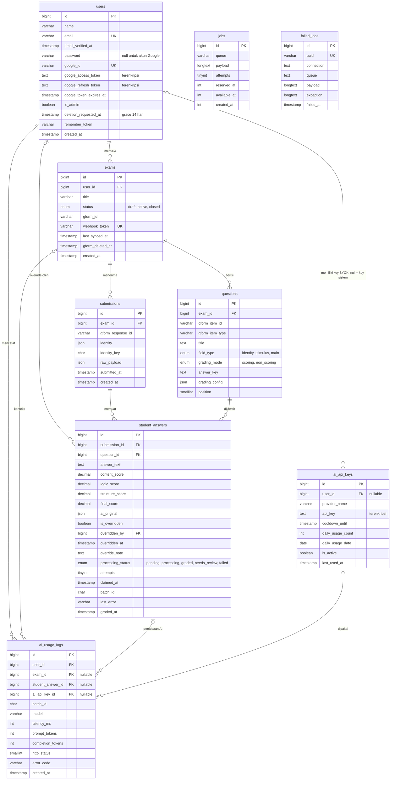

# Spesifikasi Skema Database & ERD: Essay Grader

*Dokumentasi skema MySQL 8.0 (InnoDB) untuk aplikasi Essay Grader. Disusun oleh Database Architect & Senior Data Engineer. Versi 1.0 (Draft), turunan dari PRD-EG-001 dan System Architecture Document.*

## 1. Ringkasan dan Konvensi

Skema memiliki **9 tabel aplikasi**: tujuh tabel domain (`users`, `exams`, `questions`, `submissions`, `student_answers`, `ai_api_keys`, `ai_usage_logs`) dan dua tabel antrean Laravel (`jobs`, `failed_jobs`). Seluruh data ujian terisolasi per pemilik lewat rantai `users` → `exams` → turunannya.

| Konvensi | Ketentuan |
| --- | --- |
| Engine dan charset | InnoDB, `utf8mb4`, collation `utf8mb4_unicode_ci`. Kolom teknis (ID Google, token, hash) memakai `ascii` + `ascii_bin` agar indeks ringkas dan pencocokan peka huruf besar/kecil |
| Primary key | `BIGINT UNSIGNED AUTO_INCREMENT`; kolom FK bertipe sama |
| Waktu | `created_at` / `updated_at` gaya Laravel, disimpan UTC |
| Enkripsi | Kolom bertanda *terenkripsi* memakai `encrypted` cast Laravel; ciphertext lebih panjang dari plaintext sehingga bertipe `TEXT` dan tidak bisa diindeks atau dicari |
| CHECK constraint | Ditegakkan sejak MySQL 8.0.16 |
| Tanda † | Kolom atau indeks **tambahan usulan** di luar daftar wajib, berasal dari kebutuhan System Architecture Document (klaim batch, pemulihan klaim, audit). Dapat dibuang tanpa mengubah entitas inti |

## 2. Entity Relationship Diagram



`jobs` dan `failed_jobs` tidak memiliki FK karena dikelola framework dan merujuk data aplikasi hanya lewat isi `payload`.

### 2.1 Kardinalitas Relasi

| Induk → Anak | Kardinalitas | Kolom FK | Aturan hapus |
| --- | --- | --- | --- |
| `users` → `exams` | 1 : N | `exams.user_id` | CASCADE |
| `users` → `ai_api_keys` | 0..1 : N (`user_id` null = key sistem/pool) | `ai_api_keys.user_id` | CASCADE |
| `users` → `ai_usage_logs` | 1 : N | `ai_usage_logs.user_id` | CASCADE |
| `users` → `student_answers` (override) | 0..1 : N | `student_answers.overridden_by` | SET NULL |
| `exams` → `questions` | 1 : N | `questions.exam_id` | CASCADE |
| `exams` → `submissions` | 1 : N | `submissions.exam_id` | CASCADE |
| `exams` → `ai_usage_logs` | 0..1 : N | `ai_usage_logs.exam_id` | SET NULL |
| `submissions` → `student_answers` | 1 : N | `student_answers.submission_id` | CASCADE |
| `questions` → `student_answers` | 1 : N | `student_answers.question_id` | CASCADE |
| `student_answers` → `ai_usage_logs` | 0..1 : N | `ai_usage_logs.student_answer_id` | SET NULL |
| `ai_api_keys` → `ai_usage_logs` | 0..1 : N | `ai_usage_logs.ai_api_key_id` | SET NULL |

## 3. Kamus Data

Kolom **Kunci / Index** memakai notasi: PK, UQ (unique), IX (index), FK → tabel.kolom (aksi hapus).

### 3.1 `users`

| Kolom | Tipe | Null / Default | Kunci / Index | Deskripsi bisnis |
| --- | --- | --- | --- | --- |
| `id` | BIGINT UNSIGNED AI | NOT NULL | PK | Identitas internal pengguna |
| `name` | VARCHAR(255) | NOT NULL |  | Nama tampilan pendidik |
| `email` | VARCHAR(255) | NOT NULL | UQ | Email login dan kunci penautan akun Google |
| `email_verified_at` | TIMESTAMP | NULL |  | Waktu verifikasi; akun Google terisi saat OAuth jika email terverifikasi |
| `password` | VARCHAR(255) | NULL |  | Hash bcrypt/argon2; NULL untuk akun yang hanya memakai Google |
| `google_id` | VARCHAR(255) | NULL | UQ | Subject (`sub`) akun Google yang tertaut |
| `google_access_token` | TEXT | NULL |  | Token akses, terenkripsi; dipakai `GoogleClient` |
| `google_refresh_token` | TEXT | NULL |  | Refresh token, terenkripsi; dihapus saat koneksi Google dicabut |
| `google_token_expires_at` | TIMESTAMP | NULL |  | Kedaluwarsa access token, memicu refresh otomatis |
| `is_admin` | TINYINT(1) | NOT NULL, default 0 |  | Flag administrator; tidak menaikkan akses ke data ujian pengguna lain kecuali lewat policy eksplisit |
| `deletion_requested_at` | TIMESTAMP | NULL | IX | Awal masa tenggang 14 hari. NULL = akun aktif. Job purge menghapus akun yang nilainya ≤ sekarang dikurangi 14 hari |
| `remember_token` | VARCHAR(100) | NULL |  | Token sesi "ingat saya" (Laravel) |
| `created_at`, `updated_at` | TIMESTAMP | NULL |  | Jejak waktu baris |

### 3.2 `exams`

| Kolom | Tipe | Null / Default | Kunci / Index | Deskripsi bisnis |
| --- | --- | --- | --- | --- |
| `id` | BIGINT UNSIGNED AI | NOT NULL | PK | Identitas ujian |
| `user_id` | BIGINT UNSIGNED | NOT NULL | FK → users.id (CASCADE); IX komposit (`user_id`, `status`) | Pemilik ujian; akar isolasi multi-tenant |
| `title` | VARCHAR(255) | NOT NULL |  | Judul ujian, disalin dari Google Form |
| `status` | ENUM('draft','active','closed') | NOT NULL, default 'draft' | bagian IX komposit | draft: struktur form masih dikonfirmasi, belum disinkron. active: sinkron dan penilaian berjalan. closed: sinkron berhenti, data tetap bisa ditinjau dan diekspor |
| `gform_id` | VARCHAR(128) ascii\_bin | NOT NULL | UQ (`user_id`, `gform_id`) † | ID Google Form; mencegah satu pengguna menautkan form yang sama dua kali |
| `webhook_token` | VARCHAR(64) ascii\_bin | NOT NULL | UQ | Token acak rahasia pada URL webhook yang memicu sinkronisasi di luar polling terjadwal; dapat dirotasi |
| `last_synced_at` | TIMESTAMP | NULL |  | Penanda sinkronisasi inkremental; NULL = belum pernah sinkron |
| `gform_deleted_at` | TIMESTAMP | NULL |  | Terisi saat Google melaporkan form hilang atau akses dicabut (404/403). Sinkron berhenti, data hasil tetap dipertahankan |
| `created_at`, `updated_at` | TIMESTAMP | NULL |  | Jejak waktu baris |

### 3.3 `questions`

| Kolom | Tipe | Null / Default | Kunci / Index | Deskripsi bisnis |
| --- | --- | --- | --- | --- |
| `id` | BIGINT UNSIGNED AI | NOT NULL | PK | Identitas soal |
| `exam_id` | BIGINT UNSIGNED | NOT NULL | FK → exams.id (CASCADE); UQ (`exam_id`, `gform_item_id`) | Ujian induk |
| `gform_item_id` | VARCHAR(64) ascii\_bin | NOT NULL | bagian UQ | ID item pada Google Form; kunci idempotensi saat struktur dianalisis ulang |
| `gform_item_type` | VARCHAR(32) | NOT NULL |  | Tipe item mentah Google (misalnya teks pendek, paragraf, pilihan, teks/gambar) |
| `title` | TEXT | NOT NULL |  | Teks pertanyaan atau konteks |
| `field_type` | ENUM('identity','stimulus','main') | NOT NULL | IX (`exam_id`, `field_type`) † | identity: field identitas siswa (nama, NIM, email). stimulus: teks/kasus/gambar pendahulu yang tidak dijawab. main: pertanyaan yang dijawab siswa |
| `grading_mode` | ENUM('scoring','non\_scoring') | NOT NULL, default 'scoring' |  | scoring: dinilai. non\_scoring: jawaban disimpan tetapi tidak dinilai (misalnya pertanyaan opini). Berlaku untuk `main` |
| `answer_key` | TEXT | NULL |  | Kunci jawaban atau jawaban acuan. Format isi (acuan esai, daftar alternatif, pola regex) ditentukan service penilai |
| `grading_config` † | JSON | NULL |  | Bobot tiga parameter, batas panjang jawaban, dan mode pencocokan short answer |
| `position` † | SMALLINT UNSIGNED | NOT NULL, default 0 |  | Urutan tampil sesuai form |
| `created_at`, `updated_at` | TIMESTAMP | NULL |  | Jejak waktu baris |

### 3.4 `submissions`

| Kolom | Tipe | Null / Default | Kunci / Index | Deskripsi bisnis |
| --- | --- | --- | --- | --- |
| `id` | BIGINT UNSIGNED AI | NOT NULL | PK | Satu pengiriman form oleh satu siswa |
| `exam_id` | BIGINT UNSIGNED | NOT NULL | FK → exams.id (CASCADE) | Ujian induk |
| `gform_response_id` | VARCHAR(128) ascii\_bin | NOT NULL | UQ (`exam_id`, `gform_response_id`) | ID respons Google. Menjamin idempotensi sinkronisasi: respons yang sama tidak pernah tersimpan dua kali |
| `identity` | JSON | NULL |  | Identitas terpetakan, misalnya nama, NIM, email, hasil `IdentityFilter` |
| `identity_key` | CHAR(64) ascii\_bin | NULL | IX (`exam_id`, `identity_key`) | Hash SHA-256 dari identitas ternormalisasi; kunci pencarian karena kolom JSON tidak bisa diindeks langsung. NULL bila identitas tidak terdeteksi |
| `raw_payload` | JSON | NULL |  | Respons mentah dari Google untuk audit dan pemrosesan ulang; kandidat purge setelah masa retensi |
| `submitted_at` † | TIMESTAMP | NULL |  | Waktu pengiriman menurut Google |
| `created_at`, `updated_at` | TIMESTAMP | NULL |  | Waktu baris tersimpan di sistem |

### 3.5 `student_answers`

Skala skor: setiap parameter dan `final_score` bernilai 0,00 sampai 100,00. Pemetaan `content`, `logic`, `structure` ke parameter di PRD dibahas di Bagian 7.

| Kolom | Tipe | Null / Default | Kunci / Index | Deskripsi bisnis |
| --- | --- | --- | --- | --- |
| `id` | BIGINT UNSIGNED AI | NOT NULL | PK | Satu jawaban untuk satu soal |
| `submission_id` | BIGINT UNSIGNED | NOT NULL | FK → submissions.id (CASCADE); UQ (`submission_id`, `question_id`) | Pengiriman induk |
| `question_id` | BIGINT UNSIGNED | NOT NULL | FK → questions.id (CASCADE); bagian UQ dan IX (`processing_status`, `question_id`) | Soal yang dijawab |
| `answer_text` | TEXT | NULL |  | Teks jawaban siswa; NULL atau kosong = tidak menjawab |
| `content_score` | DECIMAL(5,2) | NULL | CHECK 0..100 | Skor parameter isi/ketepatan konsep yang berlaku saat ini (setelah override bila ada) |
| `logic_score` | DECIMAL(5,2) | NULL | CHECK 0..100 | Skor parameter penalaran/logika yang berlaku saat ini |
| `structure_score` | DECIMAL(5,2) | NULL | CHECK 0..100 | Skor parameter struktur/kejelasan yang berlaku saat ini |
| `final_score` | DECIMAL(5,2) | NULL | CHECK 0..100 | Nilai akhir: jumlah berbobot parameter, dihitung aplikasi, atau nilai manual hasil override. Short answer deterministik hanya mengisi kolom ini |
| `ai_original` | JSON | NULL |  | Potret **tidak berubah** keluaran penilai otomatis: skor tiap parameter, total, alasan, model, keyakinan. Sumber untuk *revert* |
| `is_overridden` | TINYINT(1) | NOT NULL, default 0 | CHECK: 0 atau `overridden_at` terisi | Penanda nilai diubah pendidik |
| `overridden_by` | BIGINT UNSIGNED | NULL | FK → users.id (SET NULL) | Pengguna yang melakukan override terakhir |
| `overridden_at` | TIMESTAMP | NULL |  | Waktu override terakhir |
| `override_note` | TEXT | NULL |  | Catatan alasan override (opsional) |
| `processing_status` | ENUM('pending','processing','graded','needs\_review','failed') | NOT NULL, default 'pending' | IX (`processing_status`, `question_id`) | Status antrean penilaian. Override bersifat ortogonal terhadap status ini |
| `attempts` | TINYINT UNSIGNED | NOT NULL, default 0 |  | Jumlah percobaan klaim penilaian; melewati batas = `failed` |
| `claimed_at` † | TIMESTAMP | NULL |  | Waktu klaim batch; dasar pemulihan klaim macet |
| `batch_id` † | CHAR(36) ascii\_bin | NULL |  | UUID batch yang mengklaim; syarat pembaruan bersyarat hasil |
| `last_error` † | VARCHAR(255) | NULL |  | Ringkasan galat terakhir untuk antrean review |
| `graded_at` † | TIMESTAMP | NULL |  | Waktu penilaian otomatis selesai |
| `created_at`, `updated_at` | TIMESTAMP | NULL |  | Jejak waktu baris |

### 3.6 `ai_api_keys`

| Kolom | Tipe | Null / Default | Kunci / Index | Deskripsi bisnis |
| --- | --- | --- | --- | --- |
| `id` | BIGINT UNSIGNED AI | NOT NULL | PK | Identitas key |
| `user_id` | BIGINT UNSIGNED | NULL | FK → users.id (CASCADE); IX (`user_id`, `provider_name`) | Pemilik key (BYOK). NULL = key sistem milik platform yang dipakai bersama |
| `provider_name` | VARCHAR(50) | NOT NULL, default 'groq' | bagian IX | Penyedia LLM; memungkinkan penyedia lain tanpa ubah skema |
| `api_key` | TEXT | NOT NULL |  | API key, terenkripsi; tidak pernah ditampilkan utuh |
| `cooldown_until` | TIMESTAMP | NULL | IX (`provider_name`, `is_active`, `cooldown_until`) † | Key tidak boleh dipakai sampai waktu ini (setelah 429); NULL atau lampau = siap |
| `daily_usage_count` | INT UNSIGNED | NOT NULL, default 0 |  | Jumlah pemakaian pada `daily_usage_date`, untuk pembatasan kuota harian |
| `daily_usage_date` † | DATE | NULL |  | Tanggal hitungan; bila berbeda dari hari ini, hitungan direset |
| `is_active` † | TINYINT(1) | NOT NULL, default 1 | bagian IX | Menonaktifkan key tanpa menghapus riwayat |
| `last_used_at` † | TIMESTAMP | NULL |  | Pemakaian terakhir |
| `created_at`, `updated_at` | TIMESTAMP | NULL |  | Jejak waktu baris |

### 3.7 `ai_usage_logs`

Tabel *append-only*: baris tidak pernah diubah setelah ditulis (tanpa `updated_at`).

| Kolom | Tipe | Null / Default | Kunci / Index | Deskripsi bisnis |
| --- | --- | --- | --- | --- |
| `id` | BIGINT UNSIGNED AI | NOT NULL | PK | Satu percobaan pemanggilan AI untuk satu jawaban |
| `user_id` | BIGINT UNSIGNED | NOT NULL | FK → users.id (CASCADE); IX (`user_id`, `created_at`) | Pengguna yang kuotanya terpakai |
| `exam_id` † | BIGINT UNSIGNED | NULL | FK → exams.id (SET NULL) | Konteks ujian; NULL untuk panggilan non-ujian (validasi key) |
| `student_answer_id` | BIGINT UNSIGNED | NULL | FK → student\_answers.id (SET NULL); IX | Jawaban yang dinilai; NULL untuk panggilan tanpa jawaban atau setelah jawaban dihapus |
| `ai_api_key_id` | BIGINT UNSIGNED | NULL | FK → ai\_api\_keys.id (SET NULL); IX (`ai_api_key_id`, `created_at`) | Key yang dipakai |
| `batch_id` † | CHAR(36) ascii\_bin | NULL | IX | Mengelompokkan baris dari satu request batch |
| `model` | VARCHAR(100) | NOT NULL |  | Model yang dipakai, termasuk model fallback |
| `latency_ms` | INT UNSIGNED | NULL |  | Durasi request hingga respons |
| `prompt_tokens` | INT UNSIGNED | NOT NULL, default 0 |  | Token masukan; untuk batch dialokasikan proporsional per jawaban (aproksimasi) |
| `completion_tokens` | INT UNSIGNED | NOT NULL, default 0 |  | Token keluaran, dengan aturan alokasi sama |
| `http_status` † | SMALLINT UNSIGNED | NULL |  | Kode HTTP dari penyedia |
| `error_code` | VARCHAR(50) | NULL |  | Kode galat terklasifikasi (misalnya rate\_limited, invalid\_json, timeout); NULL = sukses |
| `created_at` | TIMESTAMP | NOT NULL, default CURRENT\_TIMESTAMP |  | Waktu pemanggilan |

### 3.8 `jobs`

Tabel standar Laravel untuk driver antrean database.

| Kolom | Tipe | Null / Default | Kunci / Index | Deskripsi bisnis |
| --- | --- | --- | --- | --- |
| `id` | BIGINT UNSIGNED AI | NOT NULL | PK | Urutan job (FIFO) |
| `queue` | VARCHAR(255) | NOT NULL | IX | Jalur antrean: `sync`, `grading`, `default` |
| `payload` | LONGTEXT | NOT NULL |  | Job serial (kelas dan data) |
| `attempts` | TINYINT UNSIGNED | NOT NULL |  | Jumlah percobaan eksekusi |
| `reserved_at` | INT UNSIGNED | NULL |  | Unix time job diambil worker; NULL = belum diambil |
| `available_at` | INT UNSIGNED | NOT NULL |  | Unix time job boleh dijalankan (untuk delay dan backoff) |
| `created_at` | INT UNSIGNED | NOT NULL |  | Unix time job dibuat |

### 3.9 `failed_jobs`

| Kolom | Tipe | Null / Default | Kunci / Index | Deskripsi bisnis |
| --- | --- | --- | --- | --- |
| `id` | BIGINT UNSIGNED AI | NOT NULL | PK | Identitas baris dead-letter |
| `uuid` | VARCHAR(255) | NOT NULL | UQ | UUID job; dasar `queue:retry` |
| `connection` | TEXT | NOT NULL |  | Koneksi antrean asal |
| `queue` | TEXT | NOT NULL |  | Jalur antrean asal |
| `payload` | LONGTEXT | NOT NULL |  | Payload job gagal |
| `exception` | LONGTEXT | NOT NULL |  | Jejak exception terakhir |
| `failed_at` | TIMESTAMP | NOT NULL, default CURRENT\_TIMESTAMP |  | Waktu gagal permanen |

Tabel framework lain di luar ERD tetapi dibutuhkan arsitektur bila cache bertipe database: `cache` dan `cache_locks` (penyimpanan cooldown, rate limiter, dan kunci `ShouldBeUnique`), serta `migrations`.

## 4. Strategi Indexing dan Optimasi Query

### 4.1 Mengapa `exams (user_id, status)` penting

Setiap query ujian pada aplikasi dibatasi `user_id` oleh global scope isolasi tenant, dan hampir selalu ditambah status, misalnya daftar ujian aktif di dashboard:

```sql
SELECT id, title, last_synced_at FROM exams
WHERE user_id = ? AND status = 'active'
ORDER BY created_at DESC;
```

- `user_id` berada di depan karena sangat selektif (satu pemilik hanya punya puluhan ujian) sedangkan `status` hanya tiga nilai; indeks `status` sendirian nyaris tidak menyaring apa pun.
- Aturan *leftmost prefix* membuat indeks yang sama melayani query `WHERE user_id = ?` saja. Karena itu tidak perlu indeks terpisah pada `user_id`, dan InnoDB memakai indeks komposit ini sebagai indeks pendukung FK.
- Tanpa indeks ini, setiap pemuatan dashboard memindai seluruh tabel `exams` seiring pertumbuhan jumlah pengguna.
- **Catatan:** query scheduler lintas pengguna (`WHERE status = 'active' AND gform_deleted_at IS NULL`) tidak terlayani indeks ini karena tidak memfilter `user_id`. Usulan †: indeks tambahan (`status`, `last_synced_at`) agar pemilihan ujian yang perlu disinkron tetap murah.

### 4.2 Fungsi `submissions (exam_id, identity_key)`

Saat `ResponseSyncService` menyimpan respons baru, ia harus mengetahui seketika apakah siswa yang sama sudah mengirim sebelumnya:

```sql
SELECT id, gform_response_id FROM submissions
WHERE exam_id = ? AND identity_key = ?;
```

- Dengan indeks ini hasilnya adalah satu pencarian indeks (akses `ref`) yang mengembalikan nol atau segelintir baris, berapa pun jumlah respons pada ujian tersebut; tanpanya, deteksi duplikasi menjadi pemindaian seluruh pengiriman ujian untuk **setiap** respons baru.
- Indeks dibuat pada hash `identity_key`, bukan pada kolom JSON `identity`: JSON tidak dapat diindeks langsung, sedangkan hash ternormalisasi berukuran tetap, kecil (64 byte pada `ascii_bin`), dan tidak membuka data identitas mentah sebagai kunci.
- Indeks ini **sengaja tidak unik**. Kebijakan pengiriman ulang (pengiriman terakhir dinilai, riwayat dipertahankan) membutuhkan baris lama tetap ada. Pencegahan duplikasi *teknis* dilakukan oleh indeks unik terpisah (`exam_id`, `gform_response_id`), yang juga menjadi syarat `upsert` Laravel dan membuat sinkronisasi idempoten di tingkat database.

### 4.3 Fungsi `student_answers (processing_status, question_id)`

Indeks ini melayani query klaim batch worker (esai 5 jawaban, short answer 40 jawaban):

```sql
START TRANSACTION;
SELECT id FROM student_answers
WHERE processing_status = 'pending' AND question_id IN (/* soal esai ujian */)
ORDER BY id LIMIT 5
FOR UPDATE SKIP LOCKED;
UPDATE student_answers
SET processing_status = 'processing', claimed_at = NOW(), batch_id = ?, attempts = attempts + 1
WHERE id IN (/* hasil SELECT */);
COMMIT;
```

- Kesamaan pada `processing_status = 'pending'` langsung menyempitkan pencarian ke irisan kecil tabel (sebagian besar baris sudah `graded`), lalu `question_id` memilah per soal. Entri indeks InnoDB otomatis berisi PK, sehingga urutan indeks adalah (`processing_status`, `question_id`, `id`) dan `ORDER BY id LIMIT` per soal dapat dibaca berurutan tanpa pengurutan ulang.
- Dampak terpenting ada pada penguncian: `FOR UPDATE` mengunci catatan indeks yang **dipindai**. Dengan indeks tepat, yang terkunci hanya kandidat yang cocok; tanpanya, pemindaian tabel akan mengunci banyak baris tak terkait dan memperbesar kontensi antar-worker. `SKIP LOCKED` lalu membuat worker lain melompati baris yang sedang diklaim.
- Indeks yang sama melayani pemulihan klaim macet (`processing_status = 'processing' AND claimed_at < ?`), karena irisan `processing` selalu kecil.
- Biaya: setiap perubahan status memindahkan entri pada indeks ini. Biaya itu kecil dibandingkan latensi panggilan LLM yang menjadi hambatan sesungguhnya.

### 4.4 Indeks Lain dan Optimasi Lanjutan

| Tabel | Indeks | Melayani |
| --- | --- | --- |
| `users` | UQ `email`, UQ `google_id`, IX `deletion_requested_at` | Login, penautan OAuth, job purge akun harian |
| `exams` | UQ `webhook_token` | Pencarian ujian dari URL webhook dalam satu lookup |
| `questions` | UQ (`exam_id`, `gform_item_id`) | Idempotensi analisis ulang struktur form |
| `student_answers` | UQ (`submission_id`, `question_id`) | Satu jawaban per soal per pengiriman; upsert idempoten; juga indeks FK `submission_id` |
| `ai_api_keys` | IX (`provider_name`, `is_active`, `cooldown_until`) † | Memilih key sistem yang siap pakai |
| `ai_usage_logs` | IX (`user_id`, `created_at`), IX (`ai_api_key_id`, `created_at`) | Rekap pemakaian per pengguna dan per key |
| `jobs` | IX `queue` | Pengambilan job per jalur antrean |

**Optimasi opsional:**

1. `student_answers` tidak memiliki `exam_id`, sehingga hitungan status per ujian untuk `LiveState` harus *join* melalui `questions`. Bila polling menjadi hotspot, denormalisasi `exam_id` ke `student_answers` dengan indeks (`exam_id`, `processing_status`) membuatnya satu agregat `GROUP BY` pada indeks. Konsekuensi: satu kolom redundan yang harus dijaga konsisten saat insert.
2. Verifikasi semua query di atas dengan `EXPLAIN` pada data uji realistis (misalnya 100.000 jawaban) dan pantau `type`, `key`, serta `rows`.

## 5. Integritas Data dan Aturan Cascading

### 5.1 Kebijakan `cascade` vs `nullOnDelete`

Prinsipnya: **data milik** dihapus bersama induknya (`cascade`), sedangkan **referensi pencatat** dipertahankan dengan mengosongkan penunjuk (`nullOnDelete`), agar jejak tetap ada tanpa menyisakan FK yatim.

| FK | Aksi | Alasan |
| --- | --- | --- |
| `exams.user_id` | CASCADE | Ujian adalah milik pengguna; hapus akun harus menghapus seluruh ujiannya (PRD FR-PRV-03) |
| `questions.exam_id`, `submissions.exam_id` | CASCADE | Tidak bermakna tanpa ujian |
| `student_answers.submission_id`, `.question_id` | CASCADE | Jawaban bergantung pada pengiriman dan soal |
| `ai_api_keys.user_id` | CASCADE | Key BYOK adalah rahasia pengguna dan harus ikut terhapus. Key sistem (`user_id` NULL) tidak terpengaruh |
| `ai_usage_logs.user_id` | CASCADE | Log adalah data pengguna; hilang pada penghapusan akun |
| `ai_usage_logs.exam_id`, `.student_answer_id`, `.ai_api_key_id` | SET NULL | Catatan biaya dan latensi tetap bernilai setelah ujian, jawaban, atau key dibuang. Log hanya berisi metadata, bukan teks jawaban |
| `student_answers.overridden_by` | SET NULL | Nilai hasil override tidak boleh hilang hanya karena pelakunya terhapus |

Semua kolom bertipe SET NULL wajib `NULL`-able. MySQL melarang kolom FK yang memiliki aksi referensial dipakai pada CHECK constraint, sehingga CHECK integritas override hanya menyentuh `is_overridden` dan `overridden_at`, tidak `overridden_by`.

### 5.2 Audit Trail Override Nilai

Perubahan nilai oleh manusia harus dapat dilacak dan dibalik:

- `ai_original` menyimpan keluaran penilai otomatis yang **tidak pernah ditimpa**. Skor yang berlaku (`content_score`, `logic_score`, `structure_score`, `final_score`) adalah salinan kerja. *Revert* = menyalin balik dari `ai_original` lalu mengosongkan atribut override.
- `overridden_by` (FK → `users.id`), `overridden_at`, dan `override_note` mencatat siapa, kapan, dan mengapa. CHECK `is_overridden = 0 OR overridden_at IS NOT NULL` mencegah status override tanpa waktu.
- Hanya **override terakhir** yang tercatat pada baris. Karena `overridden_by` bisa menjadi NULL (SET NULL) dan hanya pemilik ujian atau admin yang dapat mengubah nilai, riwayat lengkap beberapa kali perubahan memerlukan tabel jejak terpisah (lihat Bagian 7, butir 3).

### 5.3 Constraint Tambahan

| Constraint | Tujuan |
| --- | --- |
| CHECK skor `BETWEEN 0 AND 100` pada empat kolom skor `student_answers` | Menolak skor di luar rentang dari bug atau output LLM liar, sebagai pertahanan terakhir setelah validasi aplikasi |
| UQ (`exam_id`, `gform_response_id`) dan UQ (`submission_id`, `question_id`) | Idempotensi tingkat database |
| NOT NULL + ENUM pada status | Mencegah status tak terdefinisi pada antrean |

### 5.4 Penghapusan Akun Berskala Besar

Cascade menghapus seluruh rantai (`users` → `exams` → `submissions` → `student_answers`) dalam satu transaksi, yang untuk ujian besar berarti ratusan ribu baris, kunci lama, dan lonjakan binlog. Job purge setelah masa tenggang 14 hari sebaiknya menghapus **bawah ke atas dalam potongan**: `student_answers` per ujian (misalnya 1.000 baris per iterasi), lalu `submissions`, `questions`, `exams`, dan terakhir `users`. FK tetap menjadi jaring pengaman bila ada baris tersisa.

## 6. Retensi dan Pertumbuhan Data

| Data | Pertumbuhan | Usulan retensi |
| --- | --- | --- |
| `submissions.raw_payload` | Terbesar per baris | Kosongkan setelah ujian `closed` dan masa tinjau berakhir |
| `ai_usage_logs` | Satu baris per jawaban per percobaan | Agregasi bulanan lalu hapus baris rinci tua; kebijakan final perlu ditetapkan |
| `jobs` | Hanya antrean aktif | Tidak membesar bila worker sehat |
| `failed_jobs` | Bertambah saat galat | Pangkas berkala (`queue:prune-failed`) setelah ditinjau |

## 7. Keselarasan dengan Dokumen Sebelumnya dan Hal Terbuka

1. **Penyimpanan Groq key.** PRD dan SAD menaruh key pada pengguna; skema ini memindahkannya ke `ai_api_keys` (`user_id` NULL = key sistem). SAD perlu menyesuaikan, terutama cooldown yang kini melekat pada baris key, bukan per pengguna.
2. **Nama parameter penilaian.** PRD memakai Ketepatan Konsep, Kelengkapan, Kejelasan dan Penalaran; skema memakai `content`, `logic`, `structure`. Perlu diputuskan pemetaan resminya (usulan: content = ketepatan konsep, logic = penalaran, structure = kejelasan dan kelengkapan) lalu menyamakan PRD, prompt, dan UI.
3. **Riwayat override.** Jika dibutuhkan jejak seluruh perubahan nilai, tambahkan tabel *append-only* (misalnya `student_answer_audits`: skor lama, skor baru, pelaku, waktu). Di luar daftar entitas wajib, jadi belum dimodelkan.
4. **Status jawaban.** SAD memakai nama kolom `status`; skema ini memakai `processing_status` sesuai spesifikasi. Kolom † (`claimed_at`, `batch_id`, `last_error`, `graded_at`) dari SAD tetap diusulkan.
5. **Webhook.** `webhook_token` ada di skema, sedangkan SAD hanya membahas polling. Mekanisme pemicu webhook (misalnya Apps Script pada form) dan kebijakan rotasi token perlu dikonfirmasi.
6. **Kebijakan pengiriman ulang** (pengiriman terakhir menggantikan atau riwayat dipertahankan) menentukan perilaku baris `submissions` dengan `identity_key` sama; perlu keputusan produk.

---

*Akhir dokumen Spesifikasi Skema Database v1.0.*
