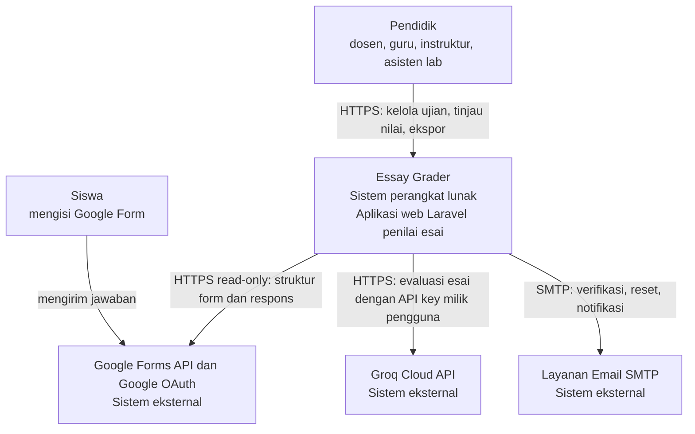
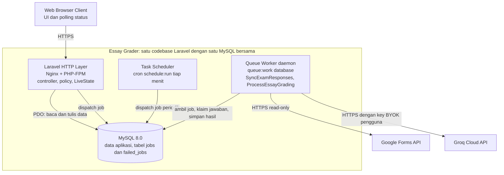
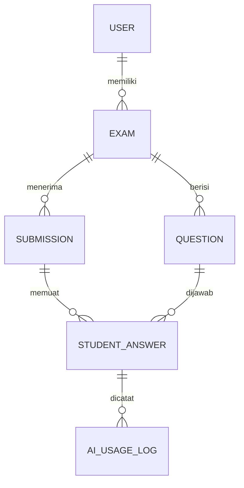
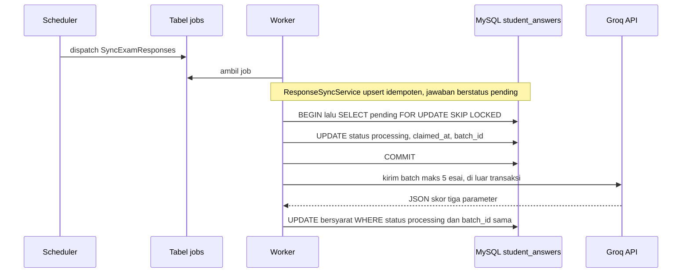

# System Architecture Document: Essay Grader

*Desain sistem dan arsitektur teknis dengan pendekatan C4 Model. Disusun oleh Principal Software Architect. Versi 1.0 (Draft), turunan dari PRD-EG-001.*

## 1. Ringkasan, Cakupan, dan Prinsip Arsitektur

### 1.1 Tujuan Dokumen

Dokumen ini menjelaskan bagaimana Essay Grader dibangun: batas sistem, container runtime, komponen internal, alur data, kontrol konkurensi, serta batasan skala. Pembaca utama adalah engineer, reviewer keamanan, dan QA.

> **Catatan sumber.** Nama kelas, job, dan tabel mengikuti spesifikasi proyek. Rincian internal lain (nama kolom, ambang waktu, konfigurasi) adalah desain target dan perlu diverifikasi terhadap basis kode saat implementasi.

> **Keselarasan dengan PRD.** PRD-EG-001 (Bagian 7.2) menyebut Redis untuk antrean, cache, dan rate limiter. Dokumen ini menetapkan **driver database** sebagai default v1.0 (alasan di Bagian 6.1); Redis menjadi opsi peningkatan tanpa perubahan kode aplikasi. PRD sebaiknya diselaraskan pada revisi berikutnya.

### 1.2 Prinsip Arsitektur

| Prinsip | Implikasi desain |
| --- | --- |
| Sederhana dulu | Satu codebase, satu database, tanpa broker tambahan |
| Idempoten di mana pun | Sinkronisasi dan penilaian aman dijalankan ulang |
| Kegagalan terisolasi | Galat satu jawaban atau satu batch tidak merusak yang lain |
| AI sebagai asisten | Nilai AI disimpan terpisah dari nilai final; pendidik dapat override |
| Patuh kuota | Rate limit Google dan Groq adalah batasan kelas satu, bukan hal sekunder |
| Privasi by design | Scope Google read-only, token terenkripsi, identitas siswa tidak dikirim ke LLM |

## 2. Arsitektur Top-Level

### 2.1 Pola: Monolitik Modular

Essay Grader adalah **satu aplikasi Laravel** yang dipecah menjadi modul berbatas jelas (namespace dan service layer), bukan microservices. Pekerjaan berat dan lambat (memanggil Google dan Groq) dipindahkan ke **background worker** berbasis **Queue driver database**, sedangkan pemicu berkala ditangani **Laravel Scheduler**. Ketiga proses memakai codebase dan database MySQL 8.0 yang sama.

| Proses runtime | Perintah / pemicu | Peran |
| --- | --- | --- |
| HTTP layer | Nginx + PHP-FPM | Antarmuka web, API internal, endpoint polling status |
| Queue worker daemon | `php artisan queue:work database --queue=sync,grading,default` (dikelola Supervisor/systemd) | Menjalankan `SyncExamResponses`, `ProcessEssayGrading`, ekspor, dan job lain |
| Task scheduler | Cron `* * * * * php artisan schedule:run` | Memicu sinkronisasi per ujian aktif, pemulihan job macet, pembersihan, penghapusan akun |

### 2.2 Pembagian Modul

| Modul | Tanggung jawab | Komponen utama |
| --- | --- | --- |
| Auth & BYOK | Login email/Google, token OAuth, Groq key | Controller auth, Socialite, enkripsi atribut model |
| Ingestion | Menarik struktur dan respons Google Form | `GoogleClient`, `ResponseSyncService`, `SyncExamResponses` |
| Structural Analysis | Deteksi tipe dan peran field | `FormAnalyzerService`, `IdentityFilter` |
| Grading | Penilaian short answer dan esai | `ProcessEssayGrading`, `ShortAnswerGrader`, `EssayGraderService`, `AiGradingService` |
| Review | Override, revert, retry, audit | Controller dan policy review |
| Reporting | Statistik, grafik, ekspor | Query agregat, job ekspor, `LiveState` |
| Account Lifecycle | Hapus akun 14 hari, ekspor data diri | Job terjadwal, status `pending_deletion` |

### 2.3 Jalur Antrean

| Queue | Isi | Alasan dipisah |
| --- | --- | --- |
| `sync` | `SyncExamResponses` | Sinkronisasi tidak boleh tertahan antrean penilaian yang panjang |
| `grading` | `ProcessEssayGrading` | Dibatasi rate limit Groq; bisa lama |
| `default` | Ekspor, email, pembersihan | Pekerjaan umum |

## 3. Diagram Arsitektur Tingkat Tinggi

### 3.1 C4 Level 1: System Context

Pendidik berinteraksi melalui browser. Sistem membaca data dari Google Forms dan mengirim teks jawaban ke Groq untuk dinilai. Google dan Groq adalah sistem eksternal yang tidak dikendalikan, sehingga seluruh interaksi dengannya dibungkus penanganan kuota dan galat.

Siswa tidak berinteraksi langsung dengan Essay Grader; semua data siswa masuk lewat Google Form.

### 3.2 C4 Level 2: Container

Semua koordinasi lewat MySQL: HTTP layer dan scheduler hanya mendorong job ke tabel `jobs`, sedangkan hanya worker yang berbicara dengan Google dan Groq.

| Dari | Ke | Protokol | Tujuan |
| --- | --- | --- | --- |
| Web Browser Client | Laravel HTTP Layer | HTTPS | UI, aksi review, ekspor, polling status |
| Laravel HTTP Layer | MySQL 8.0 | TCP (PDO) | Baca/tulis data aplikasi |
| Laravel HTTP Layer | Queue (tabel `jobs`) | via MySQL | Mendorong job (ekspor, sinkronisasi manual) |
| Task Scheduler | Queue (tabel `jobs`) | via MySQL | Mendorong job periodik |
| Queue Worker daemon | MySQL 8.0 | TCP (PDO) | Mengambil job, mengklaim jawaban, menyimpan hasil |
| Queue Worker daemon | Google Forms API | HTTPS (read-only) | Struktur form dan respons |
| Queue Worker daemon | Groq Cloud API | HTTPS | Evaluasi esai |

## 4. Dekonstruksi Komponen Utama (C4 Level 3)

### 4.1 Ingestion Layer

| Komponen | Jenis | Tanggung jawab |
| --- | --- | --- |
| `GoogleClient` | Wrapper integrasi | Membuat klien Google dari token milik pengguna, refresh token otomatis, `getForm()` dan `listResponses()` dengan paginasi, menerjemahkan 401/403/429/5xx ke exception bertipe |
| `ResponseSyncService` | Domain service | Menarik respons inkremental, menormalkan, menghitung `identity_key`, upsert ke `Submission` dan `StudentAnswer`, lalu mendorong job penilaian bila ada jawaban `pending` |
| `SyncExamResponses` | Queue job (queue `sync`) | Pembungkus eksekusi `ResponseSyncService` untuk satu ujian; `ShouldBeUnique` per `exam_id` agar tidak ada dua sinkronisasi paralel pada ujian yang sama; backoff pada 429 |

**Alur singkat.** Scheduler memicu `SyncExamResponses` per ujian aktif, job mengambil respons sejak penanda terakhir (`last_synced_at` atau timestamp respons terbaru), service melakukan upsert idempoten, dan penanda hanya dimajukan setelah seluruh halaman berhasil disimpan, sehingga kegagalan di tengah jalan aman diulang.

### 4.2 Structural Analysis Layer

`FormAnalyzerService` mengubah struktur mentah Google Form menjadi `Question` internal: tipe field (teks pendek, paragraf, pilihan, dan seterusnya) dan **peran** (`identity_name`, `identity_id`, `identity_email`, `short_answer`, `essay`, `ignored`). Layanan ini dijalankan saat form ditautkan atau saat struktur berubah, bukan pada setiap polling.

`IdentityFilter` mengklasifikasikan field identitas dengan **parsing dua tahap**:

| Tahap | Masukan | Teknik | Keluaran |
| --- | --- | --- | --- |
| 1. Struktural | Judul pertanyaan, tipe field, urutan, status wajib diisi | Pencocokan kata kunci/regex pada judul (misalnya nama, NIM, NIS, email) dan batasan tipe (hanya field teks pendek) | Kandidat peran dengan skor awal |
| 2. Berbasis nilai | Sampel jawaban nyata dari respons awal | Validasi pola nilai: format email, string numerik berpanjang tipikal untuk NIM, bentuk nama (huruf, spasi, tanpa angka) | Skor akhir dan peran terkonfirmasi atau dikoreksi |

Hasil dengan keyakinan rendah ditandai agar pendidik mengonfirmasi di pratinjau sebelum penilaian dimulai. Target akurasi klasifikasi identitas adalah F1 ≥ 95% (PRD KR2.3). Pendekatan dua tahap menutup kelemahan masing-masing: judul menyesatkan (tahap 1 salah) dikoreksi nilai nyata, dan sampel kosong atau sedikit (tahap 2 lemah) ditopang judul.

### 4.3 Grading Engine Layer

| Komponen | Peran |
| --- | --- |
| `ProcessEssayGrading` | Queue job orkestrator (queue `grading`). Mengklaim batch jawaban (Bagian 5.2), mengarahkan ke jalur deterministik atau AI, menyimpan hasil, melepas klaim, lalu mendorong dirinya lagi bila masih ada `pending` |
| `ShortAnswerGrader` | Jalur deterministik: normalisasi teks, pencocokan exact/sinonim/regex terkonfigurasi, skor biner atau parsial; tanpa panggilan jaringan |
| `EssayGraderService` | Menyusun prompt (soal, rubrik, jawaban acuan, jawaban siswa dalam pembatas), memanggil `AiGradingService`, memvalidasi skema JSON, menghitung skor total berbobot di sisi aplikasi dari tiga parameter, dan menetapkan status (`graded` atau `needs_review`) |
| `AiGradingService` | Klien Groq: mendekripsi API key milik pengguna (BYOK), memilih model utama atau cadangan, menerapkan rate limit dan cooldown, mencatat `AiUsageLog`, menerjemahkan galat HTTP ke exception bertipe |

Pemisahan `EssayGraderService` (logika domain penilaian) dari `AiGradingService` (transport) membuat penggantian penyedia LLM atau pengujian dengan *fake* tidak menyentuh logika rubrik.

**Tiga parameter esai (default).** Ketepatan Konsep 50%, Kelengkapan 30%, Kejelasan dan Penalaran 20%. Skor total dihitung aplikasi, bukan LLM, sehingga manipulasi teks oleh siswa tidak dapat langsung mengubah rumus akhir (mitigasi prompt injection, PRD NFR-CMP-02).

### 4.4 Persistence & Model Layer

Rantai relasi inti: `User` 1-N `Exam` 1-N `Question`; `Exam` 1-N `Submission` 1-N `StudentAnswer`; `Question` 1-N `StudentAnswer`; `StudentAnswer` 1-N `AiUsageLog`.

| Entitas | Kolom kunci (desain target) | Catatan |
| --- | --- | --- |
| `User` | email, password, token Google (terenkripsi), Groq key (terenkripsi), `deletion_requested_at` | Akar isolasi tenant |
| `Exam` | `user_id`, `gform_id`, status sinkronisasi, `last_synced_at`, konfigurasi bobot dan model | Semua query dibatasi `user_id` |
| `Question` | `exam_id`, `gform_question_id`, tipe, peran, kunci/rubrik, bobot | Dibuat oleh `FormAnalyzerService` |
| `Submission` | `exam_id`, `gform_response_id`, `identity_key`, data identitas, waktu kirim | **Unique** (`exam_id`, `gform_response_id`) |
| `StudentAnswer` | `submission_id`, `question_id`, teks jawaban, `status`, `claimed_at`, `attempts`, skor AI, alasan per parameter, skor final, `is_overridden` | **Unique** (`submission_id`, `question_id`); indeks (`exam_id`, `status`) |
| `AiUsageLog` | `user_id`, `exam_id`, `student_answer_id`, `batch_id`, model, token masuk/keluar, latensi, kode galat | Untuk audit, estimasi biaya, dan diagnosis |

Nilai AI asli dan nilai final disimpan di kolom terpisah, sehingga *revert* cukup menyalin balik nilai asli. Untuk request batch, satu baris log dibuat per jawaban dengan `batch_id` yang sama; token request dialokasikan proporsional (aproksimasi yang didokumentasikan) agar relasi `StudentAnswer` 1-N `AiUsageLog` tetap utuh, termasuk untuk percobaan ulang.

### 4.5 Polling & Reactive State

UI memantau progres sinkronisasi dan penilaian tanpa WebSocket dan tanpa state di server (*stateless polling*). `LiveState::snapshot()` menyusun potret ringkas satu ujian: jumlah jawaban per status, waktu sinkronisasi terakhir, status cooldown, dan jumlah jawaban *needs\_review*. Potret diserialisasi stabil lalu di-hash dengan **MD5** (hanya untuk deteksi perubahan, bukan keamanan).

| Langkah | Penjelasan |
| --- | --- |
| 1 | Klien memanggil endpoint status dengan hash terakhir yang ia ketahui |
| 2 | Server menghitung snapshot dan hash-nya |
| 3a | Hash sama: server membalas respons minimal (tanpa muatan data) |
| 3b | Hash berbeda: server mengirim snapshot lengkap dan hash baru |

Beban database dijaga ringan: satu query agregat `GROUP BY status` pada indeks (`exam_id`, `status`), hasil dapat di-cache beberapa detik per ujian, dan klien memperpanjang interval polling saat tab tidak aktif atau tidak ada perubahan. Tidak ada tabel sesi progres di server, sehingga skala horizontal HTTP tidak butuh *sticky session*.

## 5. Alur Data & Kontrol Konkurensi

### 5.1 Alur End-to-End

1. Scheduler memicu `SyncExamResponses` untuk ujian aktif (queue `sync`).
2. `ResponseSyncService` menarik respons baru via `GoogleClient`, melakukan upsert idempoten ke `Submission` dan `StudentAnswer` berstatus `pending`.
3. Service mendorong `ProcessEssayGrading` bila ada jawaban `pending`.
4. `ProcessEssayGrading` mengklaim batch, menilai (deterministik atau AI), menyimpan hasil.
5. UI memantau lewat `LiveState`; pendidik meninjau, override, revert, atau retry.
6. Pelaporan dan ekspor membaca nilai final.

### 5.2 Klaim Batch Jawaban (Pencegahan Race Condition)

Beberapa worker dapat berjalan bersamaan. Agar dua worker tidak mengambil jawaban yang sama, klaim dilakukan **atomik dalam transaksi**:

1. `DB::transaction` dimulai.
2. Pilih jawaban `pending` milik ujian dengan urutan stabil, `LIMIT` sesuai jenis batch, memakai `FOR UPDATE SKIP LOCKED` (didukung MySQL 8.0; di Laravel lewat `lock('FOR UPDATE SKIP LOCKED')`).
3. Pada transaksi yang sama, ubah status menjadi `processing`, isi `claimed_at` dan `batch_id`, dan tambah `attempts`.
4. Commit. Kunci baris dilepas; status `processing` kini menjadi **penanda klaim yang tahan lama**.
5. Pemanggilan Groq (lambat) dilakukan **di luar transaksi** agar kunci baris tidak ditahan selama detik-detik jaringan.
6. Hasil ditulis dengan pembaruan bersyarat (`WHERE id IN (...) AND status = 'processing' AND batch_id = ?`), sehingga hasil dari worker yang sudah kehilangan klaim tidak menimpa data.

Klaim bersifat atomik dan singkat; panggilan Groq yang lambat terjadi setelah commit.

`SKIP LOCKED` membuat worker kedua langsung mengambil baris lain alih-alih menunggu, sehingga tidak ada antrean kunci dan tidak ada *deadlock* karena urutan akuisisi baris yang konsisten.

**Pemulihan klaim macet.** Jika worker mati setelah klaim, baris tertahan di `processing`. Task terjadwal (setiap 5 menit) mengembalikan baris dengan `claimed_at` lebih lama dari ambang (lebih besar dari timeout job) ke `pending`, atau ke `failed` bila `attempts` sudah habis. Nilai `retry_after` antrean harus lebih besar dari timeout job agar job tidak dijalankan ganda.

### 5.3 Idempotensi Penyimpanan Respons

Dua lapis proteksi duplikasi:

| Lapis | Kunci | Mencegah | Mekanisme |
| --- | --- | --- | --- |
| Teknis | `gform_response_id` (unique per `exam_id`) | Respons yang sama terambil dua kali (polling tumpang tindih, retry job) | Upsert pada unique key; `StudentAnswer` di-upsert pada (`submission_id`, `question_id`) |
| Logis | `identity_key` | Siswa yang sama mengirim lebih dari sekali | Hash dari identitas ternormalisasi (NIM, atau email, atau nama, sesuai peran terdeteksi) |

`identity_key` dihitung dari nilai identitas yang dinormalisasi (trim, huruf kecil, hapus spasi ganda) lalu di-hash, sehingga data mentah identitas tidak dipakai sebagai kunci pencarian dan variasi penulisan tidak menciptakan siswa ganda. Bila respons baru dengan `gform_response_id` berbeda memiliki `identity_key` yang sama, kebijakan default adalah pengiriman terakhir dinilai, riwayat respons lama diarsipkan, dan jawaban yang sudah di-override manual **tidak ditimpa diam-diam**: ia ditandai `needs_review`.

### 5.4 Status Jawaban & Isolasi Kegagalan

`pending` → `processing` → `graded` | `needs_review` | `failed`. Flag `is_overridden` bersifat ortogonal terhadap status. `failed` dapat diulang manual (kembali ke `pending`).

**Isolasi kegagalan parsing JSON LLM** (berlapis, dari yang paling murah):

1. Mode keluaran JSON dan skema ketat pada permintaan, dengan `temperature` rendah.
2. Parsing ketat; bila gagal, coba ekstrak blok JSON dari teks (pagar kode, teks pembuka).
3. Validasi **per item**: item valid disimpan, item tidak valid saja yang dikembalikan ke `pending`. Satu esai bermasalah tidak membatalkan empat lainnya.
4. Bila seluruh batch gagal parse, jawaban diproses ulang **satu per satu** (ukuran batch 1) untuk mengisolasi jawaban yang memicu masalah.
5. Setelah `attempts` habis, jawaban menjadi `failed` (dead-letter, tampil di antrean review untuk retry manual) dan galat dicatat di `AiUsageLog`.

Jawaban dengan pola injeksi atau keyakinan rendah ditandai `needs_review`, bukan `failed`.

### 5.5 Rate Limit & Cooldown

Karena memakai BYOK, kuota Groq melekat pada **key milik pengguna**, bukan pada aplikasi. Karena itu limiter dan cooldown dikunci per `user_id`, bukan global.

- Batas 3 request/menit per worker ditegakkan limiter di sisi aplikasi; job yang kehabisan jatah di-*release* kembali ke antrean dengan jeda (bukan *sleep* yang menahan worker).
- Pada respons 429, `AiGradingService` membaca header retry/reset, menyimpan waktu cooldown di cache, dan job melepas klaim batch kembali ke `pending` tanpa menambah `attempts`. `LiveState` menampilkan status cooldown ke pengguna.
- Kegagalan berulang pada model utama memicu fallback ke model cadangan; model yang dipakai tercatat di `AiUsageLog`.
- Rate limit Google Forms API ditangani serupa di `GoogleClient` dengan backoff eksponensial dan jitter.

## 6. Skalabilitas & Limitasi Arsitektur

### 6.1 Mengapa Queue Database, Bukan Redis

| Faktor | Database queue (pilihan v1.0) | Redis |
| --- | --- | --- |
| Beban kerja | Dibatasi Groq (3 req/menit/worker), sehingga throughput antrean sangat rendah dibanding kemampuan tabel `jobs` | Keunggulan throughput tidak terpakai |
| Operasional | Tanpa komponen baru; cocok untuk hosting sederhana dan self-host institusi | Perlu menjalankan, memantau, dan mengamankan Redis |
| Konsistensi | Dispatch dapat satu transaksi dengan data (`afterCommit`), klaim jawaban sudah berada di MySQL | Dispatch terpisah dari transaksi database |
| Observabilitas | Dapat di-query dengan SQL; tabel `failed_jobs` bawaan | Horizon memberi dasbor lebih kaya |
| Latensi pengambilan job | Polling worker (jeda `sleep` 1 sampai 3 detik) | Hampir instan |
| Batas skala | Kontensi tabel `jobs` bila worker puluhan | Skala jauh lebih tinggi |

**Keputusan:** database queue untuk v1.0 karena hambatan sebenarnya adalah kuota eksternal, bukan broker. Klaim jawaban sengaja diletakkan pada tabel `student_answers`, **bukan** pada fitur driver, sehingga logika konkurensi tidak bergantung pada driver. Migrasi ke Redis cukup mengubah `QUEUE_CONNECTION` (dan opsional `CACHE_STORE` untuk limiter) karena seluruh job idempoten. Pemicu migrasi: lebih dari kira-kira 5 sampai 10 worker aktif, latensi antrean terukur mengganggu, atau kebutuhan Horizon.

### 6.2 Batasan Memori Worker

- Worker adalah proses PHP berumur panjang: dijalankan dengan `--memory`, `--max-jobs`, dan `--max-time` agar di-restart berkala oleh Supervisor.
- Tidak ada pemuatan seluruh jawaban ke memori: pembacaan memakai `chunkById`/`cursor`, batch kecil terbatas, dan respons Google diproses per halaman.
- Teks esai dipotong pada batas panjang per jawaban (default usulan 4.000 karakter) agar prompt tidak membengkak; yang terpotong ditandai pada hasil.
- Objek besar (respons HTTP, array hasil) dilepas setiap iterasi; `AiUsageLog` ditulis per batch, bukan ditumpuk.

### 6.3 Batas Ukuran Batch

| Jenis | Batch | Alasan |
| --- | --- | --- |
| Esai (AI) | **5 per request** | Menjaga token per request di bawah batas token/menit Groq dan jendela konteks model; membatasi *blast radius* bila JSON rusak; menjaga latensi per request tetap wajar (target p95 < 20 detik) |
| Isian singkat (deterministik) | **40 per iterasi** | Murni CPU dan memori kecil, tanpa jaringan; masih cukup kecil agar transaksi klaim singkat dan kunci baris tidak lama |

Kapasitas teoretis satu worker: 3 request × 5 esai = 15 esai/menit. Satu ujian 500 esai selesai kira-kira 34 menit dengan satu worker; dua worker dengan key yang sama tetap dibatasi kuota key tersebut, sehingga menambah worker hanya membantu bila kuota pengguna memungkinkan. Angka batas token dan request Groq berubah-ubah dan harus diverifikasi pada konsol Groq saat konfigurasi.

### 6.4 Jalur Peningkatan Skala

1. Pisahkan worker per queue (`sync` terpisah dari `grading`) dan tambah worker secara bertahap.
2. Ganti queue dan cache ke Redis (Bagian 6.1).
3. Tambah read replica MySQL untuk pelaporan dan polling `LiveState`.
4. Cache struktur form dan hasil agregat laporan.
5. Bila perlu, ekstrak modul Grading menjadi layanan terpisah; batas modul saat ini dirancang untuk memungkinkannya.

### 6.5 Limitasi yang Diketahui

| Limitasi | Dampak | Mitigasi |
| --- | --- | --- |
| Throughput dibatasi kuota Groq dan Google | Ujian besar selesai dalam hitungan menit hingga puluhan menit | Estimasi waktu selesai di UI, cooldown transparan |
| Polling Google (bukan push) | Jawaban baru muncul dengan jeda sekitar satu siklus polling | Interval terkonfigurasi, sinkronisasi manual |
| Polling status UI | Pembaruan tidak seketika | Hash MD5 dan interval adaptif menekan beban |
| Satu database untuk semua | Titik kegagalan tunggal | Backup, replica, ketersediaan tinggi bila dibutuhkan |
| Kualitas penilaian bergantung LLM | Penilaian dapat keliru | HITL, flag keyakinan, audit, set uji emas |

## 7. Keputusan Arsitektur Ringkas & Hal Terbuka

| ID | Keputusan | Alasan | Konsekuensi |
| --- | --- | --- | --- |
| ADR-01 | Monolitik modular | Tim kecil, domain tunggal, operasional sederhana | Disiplin batas modul harus dijaga lewat review |
| ADR-02 | Queue database | Hambatan ada di kuota eksternal | Jalur migrasi ke Redis disiapkan |
| ADR-03 | Klaim batch lewat transaksi dan `SKIP LOCKED` | Aman untuk banyak worker | Perlu MySQL 8.0+ dan InnoDB |
| ADR-04 | Skor total dihitung aplikasi | Menahan manipulasi dan memastikan konsistensi bobot | LLM hanya memberi skor parameter |
| ADR-05 | Polling stateless dengan hash MD5 | Tanpa WebSocket dan tanpa state server | Pembaruan tidak seketika |
| ADR-06 | Rate limit dan cooldown per pengguna (key BYOK) | Kuota Groq melekat pada key | Cache bersama antar worker diperlukan |

**Hal terbuka:** (1) Konfirmasi ambang `claimed_at` untuk pemulihan klaim macet terhadap timeout job produksi. (2) Kebijakan retensi `AiUsageLog`. (3) Apakah pengiriman ulang siswa perlu riwayat versi penuh di UI atau cukup arsip.

---

*Akhir System Architecture Document v1.0.*
